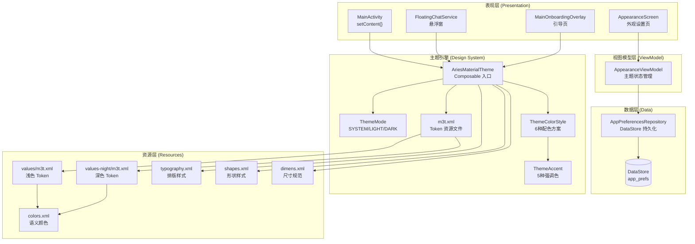
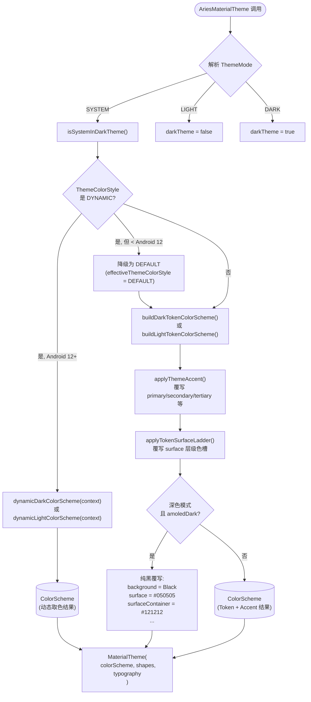
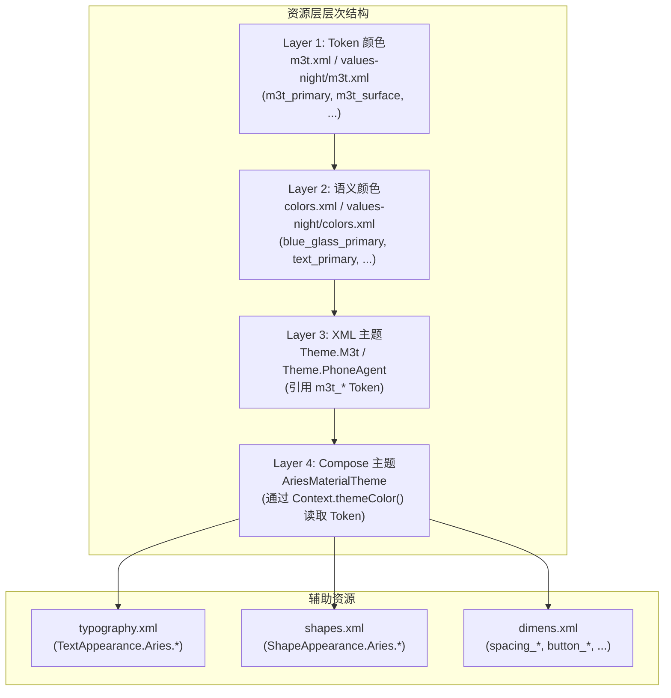
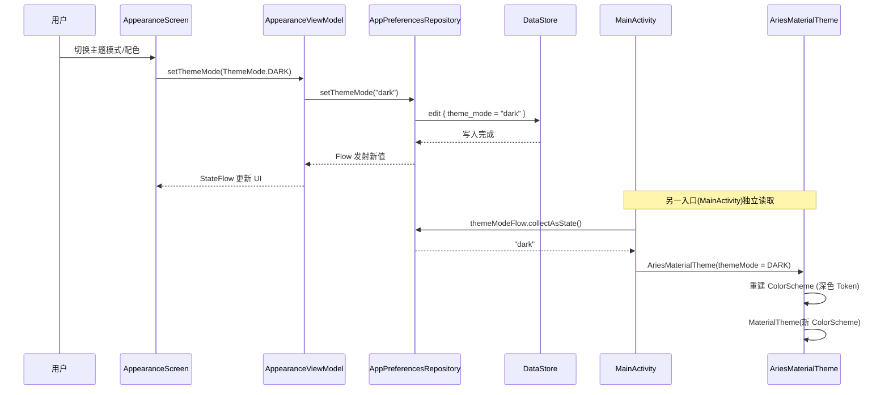

# Material 3 主题系统

Aries AI 基于 Material 3 (Material You) 规范构建了一套完整的主题系统，支持明暗模式切换、多套配色方案、AMOLED 纯黑模式、动态取色（Android 12+）以及自定义字体缩放/字体家族。主题系统采用 **单一数据源** 架构，所有的颜色、形状、排版均通过集中式 Token 资源 + Compose `AriesMaterialTheme` 可组合函数统一注入。

## 概述

### 设计目标

Aries 主题系统围绕以下核心原则设计：

1. **集中化管理** — 所有颜色、尺寸、排版、形状、组件样式通过 `m3t.xml` Token 资源文件统一定义，禁止在布局或代码中硬编码 UI 样式
2. **Material 3 原生集成** — 完全兼容 `androidx.compose.material3`，利用 `ColorScheme`、`Shapes`、`Typography` 等标准类型
3. **多维度可定制** — 支持主题模式（跟随系统/浅色/深色）、配色方案（6 种预设 + 动态取色）、AMOLED 纯黑、字体缩放等多层定制
4. **Compose 优先** — 通过 `AriesMaterialTheme` 可组合函数包裹整个 UI 树，自动向下传递主题 Token
5. **向后兼容** — 同时提供 XML View 系统的 `Theme.M3t` 主题样式家族

### 关键概念

| 概念 | 说明 |
|------|------|
| **M3T Token** | 从 `m3t.xml` 资源文件中读取的 Material 3 设计 Token，是颜色、尺寸等所有样式的唯一来源 |
| **ThemeMode** | 控制浅色/深色模式的选择策略，可选 `SYSTEM`（跟随系统）、`LIGHT`（始终浅色）、`DARK`（始终深色） |
| **ThemeColorStyle** | 配色方案枚举，包含 `DEFAULT`、`OCEAN`、`FOREST`、`SUNSET`、`ROSE` 五种预设和 `DYNAMIC`（Android 12+ 动态取色） |
| **ThemeAccent** | 强调色枚举，作为 `ThemeColorStyle` 的构建块，每个方案对应一组 light/dark 双色调色板 |
| **AMOLED Dark** | 深色模式下启用纯黑背景（`#000000`），专为 AMOLED 屏幕优化，可显著节省电量 |
| **Surface Ladder** | Material 3 定义的表面层级体系（`surfaceDim` → `surfaceBright` → `surfaceContainerLowest` …） |

---

## 架构

### 系统架构图



### 架构说明

主题系统的核心入口是 `AriesMaterialTheme` 可组合函数。当 `MainActivity` 或 `FloatingChatService` 调用 `setContent {}` 时，首先读取 `AppPreferencesRepository` 中持久化的主题偏好，然后将这些偏好转换为 `ThemeMode`、`ThemeColorStyle` 等枚举，传递给 `AriesMaterialTheme`。

`AriesMaterialTheme` 内部执行一条**优先级链**来决定最终的 `ColorScheme`：

1. **ThemeMode 解析** → 确定当前是浅色还是深色模式
2. **动态取色判断** → 如果 `ThemeColorStyle.DYNAMIC` 且 Android 12+，使用系统壁纸取色
3. **Token 基础配色** → 从 `m3t.xml` 读取浅色/深色 Token 构建基础 `ColorScheme`
4. **强调色覆写** → 如果非动态方案，用对应 `ThemeAccent` 的调色板覆写 primary/secondary/tertiary 角色
5. **Surface Ladder 覆写** → 用 Token 中的 surface 层级值覆写容器颜色
6. **AMOLED 覆写** → 如果深色模式 + AMOLED 开启，将所有背景色替换为纯黑阶梯

最后将最终的 `ColorScheme`、`Shapes`、`Typography` 注入 `MaterialTheme`，完成整个主题环境的搭建。

---

## 核心组件详解

### 1. AriesMaterialTheme — 主题入口

`AriesMaterialTheme` 是整个 Compose UI 树的主题根节点。所有依赖 Material 3 主题的 Composable 都必须在其作用域内渲染。

```kotlin
@Composable
fun AriesMaterialTheme(
    themeMode: ThemeMode = ThemeMode.SYSTEM,
    themeColorStyle: ThemeColorStyle = ThemeColorStyle.DEFAULT,
    amoledDark: Boolean = false,
    fontScale: Float = 1.0f,
    fontFamily: FontFamily = FontFamily.Default,
    content: @Composable () -> Unit,
)
```
> Source: [AriesMaterialTheme.kt](https://github.com/ZG0704666/Aries-AI/blob/main/core/designsystem/src/main/java/com/ai/phoneagent/core/designsystem/theme/AriesMaterialTheme.kt#L54-L62)

**参数说明：**

| 参数 | 类型 | 默认值 | 说明 |
|------|------|--------|------|
| `themeMode` | `ThemeMode` | `ThemeMode.SYSTEM` | 浅色/深色模式策略 |
| `themeColorStyle` | `ThemeColorStyle` | `ThemeColorStyle.DEFAULT` | 配色方案，决定主色、辅色、第三色 |
| `amoledDark` | `Boolean` | `false` | 深色模式下是否使用纯黑 AMOLED 背景 |
| `fontScale` | `Float` | `1.0f` | 字体缩放倍率，作用于所有 M3 排版级别 |
| `fontFamily` | `FontFamily` | `FontFamily.Default` | 全局字体家族 |
| `content` | `@Composable () -> Unit` | — | 主题作用域内的 Composable 内容 |

**优先级链：AMOLED > 配色方案 > Surface Ladder**

这一设计确保 AMOLED 纯黑具有最高优先级——一旦开启，所有 surface/background 颜色都会被纯黑阶梯覆写，无论当前使用的是哪种配色方案。

### 2. ThemeMode — 主题模式

```kotlin
enum class ThemeMode {
    SYSTEM,  // 跟随系统深色模式设置
    LIGHT,   // 始终浅色
    DARK,    // 始终深色
}
```
> Source: [ThemeMode.kt](https://github.com/ZG0704666/Aries-AI/blob/main/core/designsystem/src/main/java/com/ai/phoneagent/core/designsystem/theme/ThemeMode.kt#L24-L31)

`ThemeMode.SYSTEM` 通过 `isSystemInDarkTheme()` 读取系统设置，`LIGHT`/`DARK` 则强制覆盖。

### 3. ThemeColorStyle & ThemeAccent — 配色方案

`ThemeColorStyle` 是配色方案的顶层枚举，每个方案关联一个 `ThemeAccent`：

```kotlin
enum class ThemeColorStyle(val storageKey: String, val accent: ThemeAccent?) {
    DEFAULT("default", ThemeAccent.DEFAULT),
    OCEAN("ocean", ThemeAccent.OCEAN),
    FOREST("forest", ThemeAccent.FOREST),
    SUNSET("sunset", ThemeAccent.SUNSET),
    ROSE("rose", ThemeAccent.ROSE),
    DYNAMIC("dynamic", null),  // 无固定 Accent，使用系统壁纸取色
}
```
> Source: [ThemeColorStyle.kt](https://github.com/ZG0704666/Aries-AI/blob/main/core/designsystem/src/main/java/com/ai/phoneagent/core/designsystem/theme/ThemeColorStyle.kt#L5-L15)

每种强调色都定义了一组完整的 **浅色/深色双色调色板** (`ThemeAccentPalette`)，包含 `primary`、`onPrimary`、`primaryContainer`、`onPrimaryContainer`、`secondary`、`tertiary` 等 13 个色槽：

```kotlin
// 以 Ocean 浅色调色板为例
private val oceanLightPalette = ThemeAccentPalette(
    primary = Color(0xFF006495),
    onPrimary = Color(0xFFFFFFFF),
    primaryContainer = Color(0xFFCDE5FF),
    onPrimaryContainer = Color(0xFF001D31),
    inversePrimary = Color(0xFF8CCFFF),
    secondary = Color(0xFF50606F),
    // ...
)
```
> Source: [ThemeAccent.kt](https://github.com/ZG0704666/Aries-AI/blob/main/core/designsystem/src/main/java/com/ai/phoneagent/core/designsystem/theme/ThemeAccent.kt#L99-L114)

**设计意图：** 每种配色方案都定义了浅色和深色两套完整的调色板，确保无论在哪种模式下都有协调的视觉效果。`DEFAULT` 方案的 `palette()` 返回 `null`，表示直接使用 Token 文件中定义的原始颜色（即 `m3t.xml` 中的蓝色系主色）。

### 4. 颜色方案构建流程



**关键实现：Token 颜色方案构建**

`buildDarkTokenColorScheme` 和 `buildLightTokenColorScheme` 分别从浅色/深色 `m3t.xml` 中读取 Token 颜色。这里使用了一个精巧的技巧——通过 `createConfigurationContext` 根据当前 `darkTheme` 状态创建一个带夜间模式标记的 `Context`，这样 `ContextCompat.getColor()` 能自动解析到正确的 `values-night/m3t.xml` 或 `values/m3t.xml`：

```kotlin
val themeResourceContext = remember(context, configuration, darkTheme) {
    val themedConfiguration = Configuration(configuration).apply {
        val nightMode = if (darkTheme) Configuration.UI_MODE_NIGHT_YES 
                        else Configuration.UI_MODE_NIGHT_NO
        uiMode = (uiMode and Configuration.UI_MODE_NIGHT_MASK.inv()) or nightMode
    }
    context.createConfigurationContext(themedConfiguration)
}
```
> Source: [AriesMaterialTheme.kt](https://github.com/ZG0704666/Aries-AI/blob/main/core/designsystem/src/main/java/com/ai/phoneagent/core/designsystem/theme/AriesMaterialTheme.kt#L72-L78)

### 5. Shapes 形状系统

Compose 的 `Shapes` 通过 `m3t_radius_*` Token 尺寸构建，与 XML 形状资源保持一致：

```kotlin
val shapes = Shapes(
    extraSmall = RoundedCornerShape(dimensionResource(R.dimen.m3t_radius_sm)),  // 12dp
    small      = RoundedCornerShape(dimensionResource(R.dimen.m3t_radius_sm)),  // 12dp
    medium     = RoundedCornerShape(dimensionResource(R.dimen.m3t_radius_md)),  // 16dp
    large      = RoundedCornerShape(dimensionResource(R.dimen.m3t_radius_lg)),  // 24dp
    extraLarge = RoundedCornerShape(dimensionResource(R.dimen.m3t_radius_xl)),  // 32dp
)
```
> Source: [AriesMaterialTheme.kt](https://github.com/ZG0704666/Aries-AI/blob/main/core/designsystem/src/main/java/com/ai/phoneagent/core/designsystem/theme/AriesMaterialTheme.kt#L129-L136)

### 6. Typography 排版系统

所有 Material 3 的 15 个排版级别均支持 `fontScale` 缩放和 `fontFamily` 自定义：

```kotlin
val baseTypography = Typography()
val typography: Typography = Typography(
    displayLarge  = baseTypography.displayLarge.scaledBy(fontScale).withFontFamily(fontFamily),
    displayMedium = baseTypography.displayMedium.scaledBy(fontScale).withFontFamily(fontFamily),
    // ... 共 15 个级别
    labelSmall    = baseTypography.labelSmall.scaledBy(fontScale).withFontFamily(fontFamily),
)
```
> Source: [AriesMaterialTheme.kt](https://github.com/ZG0704666/Aries-AI/blob/main/core/designsystem/src/main/java/com/ai/phoneagent/core/designsystem/theme/AriesMaterialTheme.kt#L139-L157)

---

## 资源层架构

### Token 资源文件体系

整个主题的资源层分为以下层次：



### Light/Dark 颜色 Token 对照

| Token 名称 | 浅色值 | 深色值 | 用途 |
|-----------|--------|--------|------|
| `m3t_primary` | `#005AC1` | `#A9C7FF` | 主色 |
| `m3t_on_primary` | `#FFFFFF` | `#003061` | 主色上的内容色 |
| `m3t_primary_container` | `#D7E5FF` | `#134782` | 主色容器 |
| `m3t_background` | `#F5FAFF` | `#0F141B` | 页面背景 |
| `m3t_surface` | `#FFFFFF` | `#121A24` | 表面/卡片背景 |
| `m3t_surface_container` | `#E8F1FF` | `#18222E` | 表面容器 |
| `m3t_surface_container_high` | `#E2EEFF` | `#1F2A37` | 高层级表面 |

> Source (浅色): [m3t.xml](https://github.com/ZG0704666/Aries-AI/blob/main/core/designsystem/src/main/res/values/m3t.xml#L5-L35)
> Source (深色): [values-night/m3t.xml](https://github.com/ZG0704666/Aries-AI/blob/main/core/designsystem/src/main/res/values-night/m3t.xml#L5-L35)

### 语义颜色映射

`colors.xml` 定义语义颜色名称（如 `text_primary`、`button_primary`、`card_background`），在深色模式下通过 `values-night/colors.xml` 重新映射到深色 Token：

```xml
<!-- 浅色: values/colors.xml -->
<color name="text_primary">#1B2B3D</color>
<color name="surface">#FFFFFF</color>

<!-- 深色: values-night/colors.xml — 全部映射到 m3t_* Token -->
<color name="text_primary">@color/m3t_on_surface</color>      <!-- → #E1E7F1 -->
<color name="surface">@color/m3t_surface</color>               <!-- → #121A24 -->
```
> Source (深色): [values-night/colors.xml](https://github.com/ZG0704666/Aries-AI/blob/main/core/designsystem/src/main/res/values-night/colors.xml#L28-L41)

这种设计让 XML View 系统和 Compose 系统共享同一套颜色 Token，实现了 **View + Compose 混合架构下的主题一致性**。

---

## 数据流与状态管理

### 主题偏好持久化



### 关键数据流

所有主题偏好通过 `AppPreferencesRepository` 以 `Flow` 形式暴露，消费方通过 `collectAsState()` 实现响应式订阅：

**MainActivity 中的主题消费：**
```kotlin
setContent {
    val themeModeStr by appPrefsRepository.themeModeFlow.collectAsState(initial = "system")
    val themeColorStyleRaw by appPrefsRepository.themeColorStyleFlow.collectAsState(initial = ThemeColorStyle.DEFAULT.storageKey)
    val amoledDark by appPrefsRepository.amoledDarkEnabledFlow.collectAsState(initial = false)
    val fontScale by appPrefsRepository.chatFontScaleFlow.collectAsState(initial = 1.0f)

    val themeMode = when (themeModeStr.lowercase()) {
        "light" -> ThemeMode.LIGHT
        "dark"  -> ThemeMode.DARK
        else    -> ThemeMode.SYSTEM
    }

    AriesMaterialTheme(
        themeMode = themeMode,
        themeColorStyle = ThemeColorStyle.fromStorage(themeColorStyleRaw),
        amoledDark = amoledDark,
        fontScale = fontScale,
        fontFamily = resolvedFontFamily,
    ) {
        // UI 内容
    }
}
```
> Source: [MainActivity.kt](https://github.com/ZG0704666/Aries-AI/blob/main/app/src/main/java/com/ai/phoneagent/MainActivity.kt#L685-L755)

---

## XML 主题系统（View 层兼容）

虽然 Compose 是主要的 UI 框架，Aries 仍然通过 `Theme.M3t` 系列为传统 XML View（如 Dialog、BottomSheet）提供完整支持：

```xml
<!-- 基础 M3 主题，继承 Material3 DayNight -->
<style name="Theme.M3t" parent="Theme.Material3.DayNight.NoActionBar">
    <item name="colorPrimary">@color/m3t_primary</item>
    <item name="colorSurface">@color/m3t_surface</item>
    <item name="android:colorBackground">@color/m3t_background</item>
    <!-- ... 完整的 Material 3 颜色属性映射 ... -->
    <item name="android:statusBarColor">@android:color/transparent</item>
    <item name="android:navigationBarColor">@android:color/transparent</item>
    <item name="android:windowLightStatusBar">@bool/m3t_light_system_bars</item>
</style>
```
> Source: [m3t.xml](https://github.com/ZG0704666/Aries-AI/blob/main/core/designsystem/src/main/res/values/m3t.xml#L427-L465)

主题继承链：

```
Theme.Material3.DayNight.NoActionBar  (Material 3 基础)
  └── Theme.M3t                       (Aries M3T Token 主题)
        ├── Theme.M3t.App             (带 windowBackground)
        │     └── Theme.PhoneAgent    (App 入口主题)
        ├── Theme.M3t.TransparentLaunch (透明启动页)
        ├── Theme.M3t.Dialog          (对话框覆盖)
        └── Theme.M3t.BottomSheet     (底部弹窗覆盖)
```
> Source: [themes.xml](https://github.com/ZG0704666/Aries-AI/blob/main/core/designsystem/src/main/res/values/themes.xml#L3-L12)

此外还提供了兼容性别名，方便渐进迁移：
```xml
<style name="Widget.Aries.Toolbar" parent="Widget.M3t.Toolbar" />
<style name="Widget.Aries.Card" parent="Widget.M3t.Card" />
<style name="Widget.Aries.Button" parent="Widget.M3t.Button.Filled" />
```
> Source: [m3t.xml](https://github.com/ZG0704666/Aries-AI/blob/main/core/designsystem/src/main/res/values/m3t.xml#L505-L511)

---

## 使用示例

### 基本用法 — 在 Activity 中包裹主题

```kotlin
// MainActivity.kt
setContent {
    AriesMaterialTheme(
        themeMode = ThemeMode.SYSTEM,
        themeColorStyle = ThemeColorStyle.DEFAULT,
    ) {
        // 所有子 Composable 自动获取 MaterialTheme.colorScheme / typography / shapes
        MyAppContent()
    }
}
```

### 高级用法 — 读取用户偏好并响应式应用

```kotlin
// 从 AppPreferencesRepository 读取持久化偏好
setContent {
    val themeModeStr by appPrefsRepository.themeModeFlow.collectAsState(initial = "system")
    val themeColorStyleRaw by appPrefsRepository.themeColorStyleFlow
        .collectAsState(initial = ThemeColorStyle.DEFAULT.storageKey)
    val amoledDark by appPrefsRepository.amoledDarkEnabledFlow.collectAsState(initial = false)
    val fontScale by appPrefsRepository.chatFontScaleFlow.collectAsState(initial = 1.0f)

    AriesMaterialTheme(
        themeMode = when (themeModeStr.lowercase()) {
            "light" -> ThemeMode.LIGHT
            "dark"  -> ThemeMode.DARK
            else    -> ThemeMode.SYSTEM
        },
        themeColorStyle = ThemeColorStyle.fromStorage(themeColorStyleRaw),
        amoledDark = amoledDark,
        fontScale = fontScale,
    ) {
        AriesNavGraph()
    }
}
```
> Source: [MainActivity.kt](https://github.com/ZG0704666/Aries-AI/blob/main/app/src/main/java/com/ai/phoneagent/MainActivity.kt#L686-L755)

### 在 Composable 中使用主题 Token

```kotlin
// AriesSettingsListItem — 始终通过 MaterialTheme 读取颜色
ListItem(
    colors = ListItemDefaults.colors(
        containerColor = MaterialTheme.colorScheme.background,
    ),
    headlineContent = {
        Text(
            text = headlineText,
            style = MaterialTheme.typography.bodyLarge,
            color = MaterialTheme.colorScheme.onSurface,
        )
    },
    // ...
)
```
> Source: [AriesSettingsListItem.kt](https://github.com/ZG0704666/Aries-AI/blob/main/core/designsystem/src/main/java/com/ai/phoneagent/core/designsystem/theme/AriesSettingsListItem.kt#L50-L63)

### 强制 AMOLED 纯黑深色模式

```kotlin
AriesMaterialTheme(
    themeMode = ThemeMode.DARK,
    themeColorStyle = ThemeColorStyle.OCEAN,
    amoledDark = true,  // 背景变为纯黑 #000000
) {
    // 此时 background = Color.Black,
    // surface = Color(0xFF050505),
    // surfaceContainer = Color(0xFF121212) ...
}
```
> Source: [AriesMaterialTheme.kt](https://github.com/ZG0704666/Aries-AI/blob/main/core/designsystem/src/main/java/com/ai/phoneagent/core/designsystem/theme/AriesMaterialTheme.kt#L112-L127)

---

## 配置选项

### AriesMaterialTheme 参数

| 参数 | 类型 | 默认值 | 说明 |
|------|------|--------|------|
| `themeMode` | `ThemeMode` | `SYSTEM` | `SYSTEM`：跟随系统 / `LIGHT`：浅色 / `DARK`：深色 |
| `themeColorStyle` | `ThemeColorStyle` | `DEFAULT` | 配色方案，见下方枚举表 |
| `amoledDark` | `Boolean` | `false` | 深色模式下使用纯黑背景（AMOLED 优化） |
| `fontScale` | `Float` | `1.0` | 全局字体缩放比例，作用于全部 15 个 M3 排版级别 |
| `fontFamily` | `FontFamily` | `FontFamily.Default` | 全局字体家族 |

### ThemeColorStyle 配色方案

| 方案 | storageKey | 说明 | 最低 API |
|------|-----------|------|----------|
| `DEFAULT` | `"default"` | 蓝色系默认方案（Token 原始色） | API 30+ |
| `OCEAN` | `"ocean"` | 海洋蓝配色 | API 30+ |
| `FOREST` | `"forest"` | 森林绿配色 | API 30+ |
| `SUNSET` | `"sunset"` | 日落橙配色 | API 30+ |
| `ROSE` | `"rose"` | 玫瑰粉配色 | API 30+ |
| `DYNAMIC` | `"dynamic"` | 跟随系统壁纸动态取色 | API 31+ (Android 12) |

> Source: [ThemeColorStyle.kt](https://github.com/ZG0704666/Aries-AI/blob/main/core/designsystem/src/main/java/com/ai/phoneagent/core/designsystem/theme/ThemeColorStyle.kt#L5-L15)

### DataStore 持久化键

| 键名 | 类型 | 默认值 | 说明 |
|------|------|--------|------|
| `theme_mode` | `String` | `"system"` | `"system"` / `"light"` / `"dark"` |
| `theme_color_style` | `String` | `"default"` | 配色方案 storageKey |
| `theme_accent` | `String` | `"default"` | 强调色 storageKey |
| `amoled_dark_enabled` | `Boolean` | `false` | 是否启用 AMOLED 纯黑 |
| `chat_font_scale` | `Float` | `1.0` | 聊天字体缩放 |
| `chat_font_family` | `String` | `"default"` | 聊天字体家族 |

> Source: [AppPreferencesRepository.kt](https://github.com/ZG0704666/Aries-AI/blob/main/app/src/main/java/com/ai/phoneagent/data/preferences/AppPreferencesRepository.kt#L50-L59)

---

## 设计 Token 参考

### 圆角尺寸

| Token | 值 | 用途 |
|-------|-----|------|
| `m3t_radius_sm` | 12dp | 小组件（输入框、紧凑按钮） |
| `m3t_radius_md` | 16dp | 中等组件（卡片） |
| `m3t_radius_lg` | 24dp | 大组件（对话框、主按钮） |
| `m3t_radius_xl` | 32dp | 超大组件（底部弹窗顶部圆角） |

> Source: [m3t.xml](https://github.com/ZG0704666/Aries-AI/blob/main/core/designsystem/src/main/res/values/m3t.xml#L132-L135)

### 间距系统

| Token | 值 |
|-------|-----|
| `m3t_spacing_xxxs` | 2dp |
| `m3t_spacing_xs` | 4dp |
| `m3t_spacing_sm` | 8dp |
| `m3t_spacing_md` | 12dp |
| `m3t_spacing_lg` | 16dp |
| `m3t_spacing_xl` | 20dp |
| `m3t_spacing_xxl` | 24dp |

> Source: [m3t.xml](https://github.com/ZG0704666/Aries-AI/blob/main/core/designsystem/src/main/res/values/m3t.xml#L111-L118)

---

## API 参考

### `AriesMaterialTheme`

```kotlin
@Composable
fun AriesMaterialTheme(
    themeMode: ThemeMode = ThemeMode.SYSTEM,
    themeColorStyle: ThemeColorStyle = ThemeColorStyle.DEFAULT,
    amoledDark: Boolean = false,
    fontScale: Float = 1.0f,
    fontFamily: FontFamily = FontFamily.Default,
    content: @Composable () -> Unit,
)
```

Compose 主题根节点。内部完成：解析明暗模式 → 构建 ColorScheme → 应用配色 Accent → 应用 Surface Ladder → 可选 AMOLED 覆写 → 注入 `MaterialTheme`。

> Source: [AriesMaterialTheme.kt](https://github.com/ZG0704666/Aries-AI/blob/main/core/designsystem/src/main/java/com/ai/phoneagent/core/designsystem/theme/AriesMaterialTheme.kt#L54-L62)

### `ThemeColorStyle.fromStorage`

```kotlin
companion object {
    fun fromStorage(value: String): ThemeColorStyle
}
```

将持久化的 `storageKey` 字符串解析为 `ThemeColorStyle` 枚举。未识别的值安全降级为 `DEFAULT`。

> Source: [ThemeColorStyle.kt](https://github.com/ZG0704666/Aries-AI/blob/main/core/designsystem/src/main/java/com/ai/phoneagent/core/designsystem/theme/ThemeColorStyle.kt#L23-L26)

### `ThemeAccent.fromStorage`

```kotlin
companion object {
    fun fromStorage(value: String): ThemeAccent
}
```

将持久化的 `storageKey` 解析为 `ThemeAccent` 枚举。未识别的值安全降级为 `DEFAULT`。

> Source: [ThemeAccent.kt](https://github.com/ZG0704666/Aries-AI/blob/main/core/designsystem/src/main/java/com/ai/phoneagent/core/designsystem/theme/ThemeAccent.kt#L19-L22)

### `ThemeColorStyle.previewColors`

```kotlin
@Composable
fun ThemeColorStyle.previewColors(isDarkTheme: Boolean): ThemeAccentPreview?
```

在设置界面中预览配色方案的颜色。`DYNAMIC` 方案返回 `null`（无法预览动态取色结果）。

> Source: [ThemeColorStyle.kt](https://github.com/ZG0704666/Aries-AI/blob/main/core/designsystem/src/main/java/com/ai/phoneagent/core/designsystem/theme/ThemeColorStyle.kt#L29-L31)

---

## 液态玻璃（Liquid Glass）视觉层

实现入口：[AriesGlass.kt](https://github.com/ZG0704666/Aries-AI/blob/main/core/designsystem/src/main/java/com/ai/phoneagent/core/designsystem/theme/AriesGlass.kt)。规格提炼自两个参考实现：`D:\GitHub\jicun`（Flutter，自研 `lib/ui/glass.dart` 的 `GlassPanel`）与 `D:\GitHub\LootArchive`（Compose，Kyant Backdrop 的 `ui/liquidglass/`）。

### 从参考实现提炼的三条硬规则

1. **卡片不做背景模糊。** jicun 的原注释：「背景是平滑渐变，模糊它得到的像素几乎不变，每帧却要为每张卡片各跑一次全宽模糊（转场掉帧的主因）」→ 玻璃卡片只做「半透明底 + 发丝描边 + 顶部 1dp 高光」。
2. **密集卡片不画投影。** jicun 的原注释：「列表里卡片间距只有 12，而投影（blur 18 / 下移 8）会越过间隙盖到下一张卡上」→ `AriesGlassPanel(elevated = false)` 是默认值，只有浮在内容之上的独立面板才开。
3. **玻璃必须铺在有内容的画布上。** 玻璃的观感来自「透出下层」，LootArchive 的 `LiquidGlassBackground.kt` 用 `Brush.verticalGradient` 提供唯一可透来源 → 所有玻璃面都必须叠在 `AriesGlassCanvas` 之上，平涂底色上玻璃不可见。

### 档位选择规则（透明度审计结论）

「同一档玻璃在不同场景下观感完全不同」是本项目最容易踩的坑：`m3t_glass_bar` 压在**画布**上很漂亮，压在**滚动正文**上就是穿帮。选档位只看一个问题：**这层玻璃下面有没有会移动的文字？**

| 场景 | 用哪一档 | 原因 |
|------|----------|------|
| 顶栏、状态条（下面只有画布） | `m3t_glass_bar` | 无文字穿过，可以薄 |
| 抽屉、输入栏、底部面板、弹窗（下面有正文滚动） | `m3t_glass_surface_strong` | 必须挡住文字，浅色 94.9% / 深色 94.1% |
| 设置分组卡、会员卡、权限说明卡（承载文字） | `m3t_glass_surface_strong` | 低档在浅色画布上与背景同色系，卡片边界会消失 |
| 图标钮、筛选芯片、卡内小按钮（压在已不透明的面上） | `m3t_glass_bar` / `m3t_glass_surface` | 下面是实底，薄一点只是层次感 |
| 承载 markdown 正文的气泡/工具卡 | 保持 M3 实色容器 | 正文可读性优先，不参与玻璃化 |
| 悬浮窗（独立窗口，背后是桌面壁纸） | 必须完全不透明 | 没有画布可透，亮色壁纸下文字读不出 |

配套纪律：

- **深色主题只有两档可用**：`surface`(12.2% 白) 与 `bar`(16.1% 白) 都挡不住文字，需要可读性时一律 `surfaceStrong`(94.1%)。
- **正文里自带的 alpha 会复合**：容器 alpha × 文字 alpha 是相乘关系（0.52 × 0.72 ≈ 37%），承载正文的容器不要再叠 alpha，文字 alpha 也归 1。
- **弹层必须压暗下层**：`ModalBottomSheet` 的 `scrimColor` 不要设成 `Color.Transparent`，自绘弹窗也要自己补一层 48% 黑；否则弹窗与背后正文没有层次。
- **不要重复铺画布**：全局画布已由 `MainActivity` 的 `AriesGlassCanvas` 提供，页面里再画一层会让所有按画布亮度挑的 alpha 失准。
- **API 31 以下没有模糊**（`minSdk = 30`）：`Modifier.ariesGlassBackdropBlur` 会退化为 32% 黑遮罩，注释与实现必须一致，不要承诺不存在的降级。
- **导航栏对比色要关掉**：`window.isNavigationBarContrastEnforced = false`（已在 `MainActivity.setupEdgeToEdge()` 设置），否则三键导航机型会出现一条与画布不搭的带子。

### 设计 Token

颜色令牌在 `core/designsystem/src/main/res/values/m3t.xml`，深色同名镜像在 `values-night/m3t.xml`：

| Token | 浅色 | 深色 | 用途 |
|-------|------|------|------|
| `m3t_glass_surface` | `#8CFFFFFF` | `#1FFFFFFF` | 卡片、列表面板底 |
| `m3t_glass_surface_strong` | `#CCFFFFFF` | `#CC121216` | 弹窗、抽屉等高不透明底 |
| `m3t_glass_bar` | `#B3E4F0FF` | `#29FFFFFF` | 顶栏、输入栏、图标钮 |
| `m3t_glass_border` | `#266B7C90` | `#26FFFFFF` | 发丝描边（含上沿高光） |
| `m3t_glass_border_outline` | `#1F6B7C90` | `#26647188` | 外轮廓描边 |
| `m3t_glass_highlight` | `#66FFFFFF` | `#1AFFFFFF` | 顶部镜面高光 |
| `m3t_glass_shadow` | `#14000000` | `#66000000` | 柔影（仅 `elevated` 时） |
| `m3t_glass_scrim` | `#33000000` | `#66000000` | 遮罩 |
| `m3t_glass_canvas_start` / `_mid` / `_end` | `#FFFFFFFF` / `#FFF7FBFF` / `#FFEBF3FF` | `#FF0B0D12` / `#FF101520` / `#FF141A26` | 画布垂直渐变 |
| `m3t_glass_canvas_glow` | `#4DFFFFFF` | `#14FFFFFF` | 左上角柔光（光源 135°） |
| `m3t_glass_blob_primary` / `_secondary` / `_tertiary` | `#2E5AA8F0` / `#247ED8E8` / `#1F9B8CF0` | `#383B7BC8` / `#2E2A8C99` / `#2E5B4FB8` | 画布彩色光斑（右上 / 左中 / 右下），给玻璃提供可折射的内容 |

尺寸令牌在 `values/dimens.xml`：`m3t_glass_radius_card` 20dp、`m3t_glass_radius_panel` 16dp、`m3t_glass_radius_chip` 13dp、`m3t_glass_border_width` 0.5dp、`m3t_glass_blur_sigma` 12dp、`m3t_glass_blur_panel` 16dp、`m3t_glass_refraction_depth` 12dp、`m3t_glass_refraction_amount` 24dp、`m3t_glass_sheen_height` 1dp、`m3t_glass_shadow_elevation` 4dp、`m3t_glass_icon_button_size` 40dp、`m3t_glass_chip_padding_horizontal` 14dp、`m3t_glass_chip_padding_vertical` 7dp。

> `m3t_glass_refraction_depth` / `_amount` 对齐 LootArchive 的 `lens(12.dp.toPx(), 24.dp.toPx())`：前者是「距边缘多深以内参与折射」，后者是「边缘处最多向外取样多少像素」。两者任一为 0 时玻璃面退化为「提饱和 + 模糊」。

### API 参考

| API | 说明 |
|-----|------|
| `rememberAriesGlassColors(): AriesGlassColors` | 12 个玻璃色，浅/深由资源限定符自动切换 |
| `AriesGlassCanvas(modifier, colors, content)` | 渐变画布 + 左上柔光，作为页面根容器 |
| `AriesGlassPanel(modifier, shape, colors, tint, strong, elevated, borderColor, showSheen, contentPadding, content)` | 玻璃面板：半透明底 + 发丝描边 + 顶部 1dp 高光 |
| `AriesGlassIconButton(onClick, modifier, enabled, size, colors, contentColor, content)` | 玻璃图标钮 |
| `AriesGlassChip(label, selected, onClick, modifier, colors)` | 玻璃标签（选中态为强调色 15% 底 + 45% 描边） |
| `rememberAriesGlassCardShape()` / `rememberAriesGlassPanelShape()` / `rememberAriesGlassChipShape()` | 20dp / 16dp / 13dp 超椭圆圆角 |
| `AriesSquircleShape(cornerRadius, exponent = 4f, cornerSteps = 10)` | 超椭圆 `\|x/r\|^n + \|y/r\|^n = 1` 参数方程采样，零依赖替代 Kyant Capsule 的连续曲率 |
| `rememberAriesGlassBackdropBlur(): Dp` | 取 `m3t_glass_blur_sigma` |
| `Modifier.ariesGlassBlur(radius)` / `Modifier.ariesGlassBackdropBlur(enabled, radius)` | API 31+ 真模糊，低版本自动退化为不模糊 |
| `Modifier.ariesGlassBorder(shape, color, width)` | 纯矢量发丝描边（替代 `Modifier.border`）：泛型形状不再建遮罩位图，尺寸退化时不画 |

### 用法

```kotlin
AriesGlassCanvas(modifier = Modifier.fillMaxSize()) {
    Scaffold(containerColor = Color.Transparent) { padding ->
        AriesGlassPanel(modifier = Modifier.padding(padding)) {
            Text("玻璃卡片")
        }
    }
}
```

- 页面 `Scaffold` 必须把 `containerColor` 改成 `Color.Transparent`（或玻璃色），否则不透明底会盖住画布。
- 顶栏用 `AriesGlassPanel(shape = RectangleShape, tint = glassColors.bar)` 整条玻璃化。
- 弹窗、底部面板展开时给被遮挡的子树加 `Modifier.ariesGlassBackdropBlur(enabled = 弹窗可见)`，实现「背景降焦」。
- **自定义 `Shape` 一律用 `Modifier.ariesGlassBorder`，不要用 `Modifier.border`。** Compose 的 `border` 对泛型形状（超椭圆、单角圆角）会取 `createOutline().path.getBounds()` 建一张 `ImageBitmap` 当遮罩，任何一帧尺寸退化（动画首帧、被约束压到 0、路径坐标含 NaN）都会抛 `IllegalArgumentException: width and height must be > 0`——设置页曾因此 100% 闪退（详见《故障排查指南》问题九）。

### 真实背景采样（液态玻璃的捕获层）

Compose 1.7.6 起 `androidx.compose.ui:ui` 已提供 `rememberGraphicsLayer()`，因此本项目在**不升级任何依赖**的前提下实现了参考实现同款的「捕获层 + 采样器」：

| API | 作用 |
|-----|------|
| `rememberAriesGlassBackdrop()` | 创建一个捕获层（`GraphicsLayer` 包装），在 `MainActivity` 里 `remember` 后经 `LocalAriesGlassBackdrop` 下发 |
| `Modifier.ariesGlassBackdropSource(backdrop)` | 把该子树逐帧录进捕获层（`drawWithContent { record { drawContent() }; drawLayer(...) }`），并上报自身在窗口中的原点 |
| `LocalAriesGlassBackdrop` | 组合局部；为 `null` 表示「当前页面没有捕获层」，玻璃面自动退化为纯半透明底（设置页等二级页面即如此，零额外开销） |
| `Modifier.ariesGlassSurface(backdrop, shape, blurRadius, saturation, refractionDepth, refractionAmount, dimOnLegacy)` | 玻璃面本体：按自身在窗口中的位置从捕获层裁一块（四周外扩 `2 × blurRadius + refractionAmount`），挂效果链后按 `shape` 裁剪，画在半透明实底**之下** |

#### 效果链（与参考实现逐项对齐）

`vibrancy → 高斯模糊 → 透镜折射` 串成一条 `android.graphics.RenderEffect` 链（`buildAriesGlassEffectChain`），每个效果都把前一个当输入（`createBlurEffect(..., input, ...)` / `createChainEffect(outer, inner)`）：

| 阶段 | 实现 | 参数来源 |
|------|------|----------|
| 提饱和（vibrancy） | `createColorFilterEffect(ColorMatrixColorFilter(ColorMatrix().apply { setSaturation(1.5f) }))` | 参考实现 `VibrantColorFilter` 常量池：饱和度 `1.5` + Rec.709 亮度权重 `0.213 / 0.715 / 0.072`，与 `android.graphics.ColorMatrix.setSaturation` 完全一致 |
| 高斯模糊 | `createBlurEffect(r, r, input, TileMode.CLAMP)` | `m3t_glass_blur_sigma` 12dp |
| 透镜折射 | `createRuntimeShaderEffect(RuntimeShader(ARIES_LENS_SHADER), "content")` 经 `createChainEffect` 串到模糊之后 | `m3t_glass_refraction_depth` 12dp / `m3t_glass_refraction_amount` 24dp |

折射用 AGSL 着色器复刻参考实现的 `Refraction` 算法（去掉色散分支以省下 6 次采样）：以圆角矩形 SDF 为基准，形状内距边缘 `refractionHeight` 以内按 `circleMap(1 - (-sd)/refractionHeight) * refractionAmount` 计算位移，再沿 SDF 梯度（叠加 `depthEffect` 的径向分量）把采样点向外推，于是玻璃边缘会「吸入」形状外侧的背景、形成厚度感；内侧超过 `refractionHeight` 的区域直接 `content.eval(coord)` 原样透出。着色器编译一次复用，`size / offset / cornerRadii / refractionHeight / refractionAmount / depthEffect` 每帧刷新。

- **关键可行性结论**：`androidx.compose.ui.graphics.AndroidRenderEffect_androidKt.asComposeRenderEffect` 在 ui-graphics 1.7.6 中是 **public static**（按字节码访问标志核验），因此可以把自建的 `android.graphics.RenderEffect`（含 AGSL `RuntimeShader`）挂到 Compose `GraphicsLayer` 上 —— **不需要升级 Compose，也不需要引入 Kyant Backdrop**（其 `backdrop:1.0.0` 要求 Compose 1.9.4，而 Compose 的 `ui-graphics` 至今没有 `ShaderEffect` 工厂，升级也拿不到着色器 API）。
- **采样源与玻璃面必须是兄弟关系**：`ariesGlassBackdropSource` 挂在一个**只含正文**的全屏层上，顶栏 / 输入栏 / 抽屉都排在它之外。若玻璃面落在采样源内部，它会采到上一帧的自身像素并逐帧复合，形成鬼影 —— 参考实现的 `layerBackdrop`（源）与 `drawBackdrop`（玻璃面）同样按兄弟关系组织，且并未使用 `ChildLayerDependenciesTracker`。
- 采样层必须画在**半透明实底之下**（`Modifier` 链里排在 `.background()` 之前），否则模糊会被实底盖住 —— 浅色档 `m3t_glass_surface_strong` 因此从 94.9% 降到 80%（`#CCFFFFFF`），既有玻璃感又保证文字对比度。
- 画布加了三处低饱和彩色光斑（`m3t_glass_blob_*`）：玻璃要有「有内容可透」才有折射与模糊可言，近白平涂的画布上液态玻璃几乎不可见。
- API 33 以下没有 `RuntimeShader`，自动退化为「提饱和 + 模糊」；API 31 以下没有 `RenderEffect`，退化为「不模糊的采样 + 16% 压暗」（`dimOnLegacy`），不闪不崩。
- 采样窗口用 `TileMode.Clamp` 做边缘延展，避免模糊边缘出现透明光圈。

### 消费方

| 文件 | 玻璃化内容 |
|------|-----------|
| [MainActivity.kt](https://github.com/ZG0704666/Aries-AI/blob/main/app/src/main/java/com/ai/phoneagent/MainActivity.kt) | 导航图外层全局 `AriesGlassCanvas`；`rememberAriesGlassBackdrop()` + `LocalAriesGlassBackdrop` 下发捕获层；历史弹窗可见时下发 `backdropBlurEnabled` |
| [HomeScreen.kt](https://github.com/ZG0704666/Aries-AI/blob/main/app/src/main/java/com/ai/phoneagent/ui/home/HomeScreen.kt) | 内容区里「只含正文列表」的全屏层挂 `ariesGlassBackdropSource`（顶栏 / 输入栏 / 抽屉都是它的兄弟节点，不会被录进采样源）、抽屉半透明玻璃底 + 采样折射、弹层展开时下层降焦 |
| [MainTopBar.kt](https://github.com/ZG0704666/Aries-AI/blob/main/app/src/main/java/com/ai/phoneagent/ui/topbar/MainTopBar.kt) | 顶栏整条玻璃条 + 模型/状态胶囊描边 |
| [InputBar.kt](https://github.com/ZG0704666/Aries-AI/blob/main/app/src/main/java/com/ai/phoneagent/ui/inputbar/InputBar.kt) | 输入栏玻璃底 + 发丝描边 |
| [DrawerSettingsScreen.kt](https://github.com/ZG0704666/Aries-AI/blob/main/app/src/main/java/com/ai/phoneagent/ui/settings/DrawerSettingsScreen.kt) | 设置页与「模型与 API」页面：画布、玻璃顶栏、玻璃分组卡片 |
| [SettingsRoute.kt](https://github.com/ZG0704666/Aries-AI/blob/main/app/src/main/java/com/ai/phoneagent/ui/settings/SettingsRoute.kt) | 模型选择对话框：玻璃底 + 连续曲率圆角 + 描边 |
| `ui/{settings,updates,onboarding,automation}/*.kt` 8 个二级页面 | 透明 Scaffold + 玻璃顶栏，透出全局画布 |

### 纪律与已知边界

- **玻璃面不要再叠 `Modifier.ariesGlassBackdropBlur`**：真模糊由 `ariesGlassSurface` 的采样层完成；`ariesGlassBackdropBlur` 的语义是「把被遮挡的子树整体糊掉」（弹层展开时降焦），两者用途不同，叠在一起会糊两遍、还会把采样源本身糊掉。
- 页面若自带不透明底（原生 `Card(color = surface)` 等），玻璃面板会失去透出效果，需要一并改成透明或玻璃色。
- `app` 模块引用 designsystem 资源必须用 `com.ai.phoneagent.core.designsystem.R`（别名 `DesignR`），非传递 R 会让 `m3t_glass_*` 变成 `Unresolved reference`。
- **未采用 Kyant Backdrop / capsule 依赖，但复刻了它的效果链**：`io.github.kyant0:backdrop:1.0.0` 要求 Compose 1.9.4，而当前 BOM 2024.12.01（ui 1.7.6）经二进制核验**已经提供** `rememberGraphicsLayer`（声明在 `androidx.compose.ui:ui` 的 `GraphicsLayerScopeKt`，不在 `ui-graphics`）与公开的 `asComposeRenderEffect`，因此无需升级依赖 —— `AriesGlassBackdrop` + `ariesGlassSurface` 就是同一套「捕获层 + 效果链采样器」的手写实现（着色器算法、参数取值与常量均从该库的字节码提取）。若日后升级 Compose 到 1.9+，可平滑换成 `drawBackdrop(onDrawSurface = ...)`，`tint / border / sheen` 参数可原样映射。
- **不要用 `Modifier.border` 给自定义形状描边**：`drawGenericBorder` 会为泛型轮廓建遮罩位图，形状退化（尺寸为 0 / 路径含 NaN）时 `Bitmap.createBitmap` 会抛 `IllegalArgumentException: width and height must be > 0`（真机已复现的「点击设置闪退」）。一律用 `Modifier.ariesGlassBorder(shape, color, width)`。

### 验证

```bash
./gradlew :core:designsystem:compileDebugKotlin   # 设计系统单模块编译
./gradlew :app:compileDebugKotlin                 # 消费方编译（含资源链接）
./gradlew :app:assembleDebug                      # 打包
```

端上检查：首页（画布渐变 + 玻璃顶栏/输入栏）、抽屉（半透明玻璃底）、设置页与「模型与 API」（玻璃分组卡片）、历史记录弹窗展开时下层失焦。

---

## Salt Player / SaltUI 风格层

参考对象：[Salt Player 发布仓库](https://github.com/Moriafly/SaltPlayerSource)（只放 APK 与 issue，**不含 App 源码**）→ 其 UI 组件已开源为 [SaltUI](https://github.com/Moriafly/SaltUI)（坐标 `io.github.moriafly:salt-ui`）。本仓库**不引入该依赖**（只有 2.3.x 对应 Compose 1.7.6，且它会调用内部 ART API，上架 Google Play 需额外关闭 `dependenciesInfo`），而是按其度量与色板在本仓库复刻。

### 度量与色板（复刻值）

| 项 | Salt 值 | 本仓库落地 |
|----|---------|-----------|
| 分组卡圆角 | 12dp（`SaltShapes.medium`） | `m3t_salt_card_radius` + `rememberAriesSaltCardShape()` |
| 行高 | `heightIn(56.dp)` | `m3t_salt_item_height` |
| 行内图标 | 24dp 裸图标 + 12dp 间距 | `m3t_salt_item_icon`（`SettingsEntryIcon`、抽屉行） |
| 分组标题 | 12sp 次要色，padding start/end 32dp、top 20dp、bottom 4dp | `AriesSettingsSectionHeader`（色已改 `onSurfaceVariant`） |
| 主/次文本 | 16sp / 12sp | `bodyLarge` / `labelMedium`（`AriesSettingsListItem` 的 supportingText 由 bodyMedium 收窄） |
| 选中态 | 行本身不高亮；抽屉选中 = 主色 10% 底 + 12dp 圆角 | `ConversationDrawer` 会话行 |
| 阴影 | 全库无 elevation，层次靠底色差 + `Dp.Hairline` 描边 | 玻璃面板 `elevated = false` + `m3t_glass_border_width` |
| 按下反馈 | `AlphaIndication`（按下 `Black@0.3f`，顶掉 ripple） | `Modifier.ariesAlphaPress()`（`AriesInteraction.kt`） |
| 抽屉 | Salt 无抽屉；3.x `SideBar` 宽 220dp、左上 12dp 圆角、1dp 描边 | `m3t_drawer_width = 264dp`、`RoundedCornerShape(topEnd = 12dp)`、`glassColors.surfaceStrong` |

### 组件

| 组件 | 位置 | 说明 |
|------|------|------|
| `AriesSettingsSection(title, content)` | `AriesSettingsListItem.kt` | Salt 的「分组标题 + 圆角分组卡」＝ `AriesSettingsSectionHeader` + `AriesGlassPanel` |
| `AriesSettingsNavigationItem / SwitchItem / ValueItem / CustomItem` | 同上 | 行本身透明、56dp 行高、24dp 图标 |
| `AriesSettingsIconChip(icon)` | 同上 | 设置入口的图标块：42dp、13dp 圆角、20dp 图标（对应 jicun `GlassIconChip`；底色取 `primaryContainer` 以适配本项目的浅色画布） |
| `AriesSettingsOptionCard(icon, title, supportingText, onClick, showChevron)` | 同上 | 「一条设置一张玻璃卡」：`AriesGlassPanel`（12dp 超椭圆）+ 图标块 + 标题 17sp/半粗 + 副标题 13sp + 右箭头，按下走 `ariesAlphaPress` |
| `Modifier.ariesAlphaPress(onClick, …)` | `AriesInteraction.kt` | Salt 式按下变暗；`indication = null` 关掉 ripple |
| `rememberAriesSaltCardShape()` | `AriesGlass.kt` | 12dp 超椭圆（对应 Salt `medium` 圆角） |

### 页面结构约定

设置首页（`DrawerSettingsScreen`）采用 jicun `SettingsOptionCard` 的排布 —— **一条设置一张玻璃卡片**，卡片间距 12dp、左右留 20dp，标题由 `topBar` 钉在顶部（对应 jicun 的 `BoardHeader`）：

```text
Scaffold(containerColor = Color.Transparent, topBar = TopAppBar(title = "设置", containerColor = m3t_glass_bar))
└── LazyColumn(contentPadding = 20/16/20/20dp, spacedBy = m3t_settings_card_spacing 12dp)
    └── item { AriesSettingsOptionCard(icon = Lucide.Sparkles, title = "外观与主题", supportingText = …, onClick = …) }
```

- 相关令牌（`core/designsystem/src/main/res/values/dimens.xml`）：`m3t_icon_chip_size 42dp`、`m3t_icon_chip_radius 13dp`、`m3t_icon_chip_icon 20dp`、`m3t_settings_card_padding_vertical 13dp`、`m3t_settings_card_padding_end 14dp`、`m3t_settings_card_icon_gap 14dp`、`m3t_settings_card_text_gap 3dp`、`m3t_settings_card_chevron 17dp`、`m3t_settings_card_spacing 12dp`。
- 二级页面仍用「分组卡 + 行」结构：`AppearanceScreen`（主题模式 / 主题配色 / 字体大小 / 字体家族 / 代码块 五个分组）、`LicensesScreen`（单分组）、`AriesSettingsSection(title) { AriesSettingsNavigationItem(…) }`。
- 其余二级页面（`MembershipScreen` / `PermissionGuideScreen` / `UpdateHistoryScreen`）统一为「透明 Scaffold + 玻璃顶栏 + 玻璃卡片底（`m3t_glass_surface_strong`）」。

### 深浅色一致性（配套修复）

| 问题 | 修复 |
|------|------|
| 应用内主题与系统 uiMode 不一致 → 一半元素换色、一半没换 | `system/AriesThemeNightModeSync.kt`：把偏好写入 `AppCompatDelegate.setDefaultNightMode` 并留同步镜像；`AriesAgentApp` 冷启动与 `MainActivity` 的 `LaunchedEffect(themeModeStr)` 都会调用 |
| 系统栏图标明暗跟随系统而非应用 | `MainActivity.isAppThemeDark()`（读镜像）驱动 `isAppearanceLightStatusBars/NavigationBars`；`onConfigurationChanged` 重新应用 |
| View 层（悬浮窗 / 覆盖层）取到错误日夜档 | `AriesThemeNightModeSync.resolveColor(context, resId)`（覆写 uiMode 的 Context），已替换 24 处 `ContextCompat.getColor` |
| 代码块 / 图片 / Mermaid 用 `isSystemInDarkTheme()` | 改为 `LocalAriesIsDarkTheme.current` |
| 夜间缺令牌 | `values-night/m3t.xml` 补 `m3t_drawer_footer_bg`、`m3t_drawer_active_item_bg`、`m3t_drawer_scrim`、`m3t_button_light_blue`、`m3t_on_floating_header` |

### 验证

```bash
./gradlew :core:designsystem:compileDebugKotlin
./gradlew :app:compileDebugKotlin
./gradlew :app:assembleDebug
```

端上检查：设置页两个分组卡与 56dp 行高、抽屉 264dp 且左上圆角、按下无 ripple 只有变暗、切换深浅色时系统栏图标同步、浅色模式下无黑色元素、深色模式下无白色元素。
---

## 相关链接

### 核心源文件

| 文件 | 说明 |
|------|------|
| [AriesMaterialTheme.kt](https://github.com/ZG0704666/Aries-AI/blob/main/core/designsystem/src/main/java/com/ai/phoneagent/core/designsystem/theme/AriesMaterialTheme.kt) | Compose 主题入口，颜色方案构建核心 |
| [ThemeMode.kt](https://github.com/ZG0704666/Aries-AI/blob/main/core/designsystem/src/main/java/com/ai/phoneagent/core/designsystem/theme/ThemeMode.kt) | 主题模式枚举 |
| [ThemeColorStyle.kt](https://github.com/ZG0704666/Aries-AI/blob/main/core/designsystem/src/main/java/com/ai/phoneagent/core/designsystem/theme/ThemeColorStyle.kt) | 配色方案枚举 |
| [ThemeAccent.kt](https://github.com/ZG0704666/Aries-AI/blob/main/core/designsystem/src/main/java/com/ai/phoneagent/core/designsystem/theme/ThemeAccent.kt) | 强调色调色板定义 |
| [AriesSettingsListItem.kt](https://github.com/ZG0704666/Aries-AI/blob/main/core/designsystem/src/main/java/com/ai/phoneagent/core/designsystem/theme/AriesSettingsListItem.kt) | 主题驱动的设置列表组件 |
| [AriesGlass.kt](https://github.com/ZG0704666/Aries-AI/blob/main/core/designsystem/src/main/java/com/ai/phoneagent/core/designsystem/theme/AriesGlass.kt) | 液态玻璃设计系统（画布 / 面板 / 超椭圆圆角 / 背景降焦） |

### 资源文件

| 文件 | 说明 |
|------|------|
| [values/m3t.xml](https://github.com/ZG0704666/Aries-AI/blob/main/core/designsystem/src/main/res/values/m3t.xml) | 浅色模式 Token、Widget 样式、Theme.M3t 定义 |
| [values-night/m3t.xml](https://github.com/ZG0704666/Aries-AI/blob/main/core/designsystem/src/main/res/values-night/m3t.xml) | 深色模式 Token |
| [values/colors.xml](https://github.com/ZG0704666/Aries-AI/blob/main/core/designsystem/src/main/res/values/colors.xml) | 语义颜色定义（浅色） |
| [values-night/colors.xml](https://github.com/ZG0704666/Aries-AI/blob/main/core/designsystem/src/main/res/values-night/colors.xml) | 语义颜色定义（深色，映射到 m3t_* Token） |
| [values/shapes.xml](https://github.com/ZG0704666/Aries-AI/blob/main/core/designsystem/src/main/res/values/shapes.xml) | 形状样式定义 |
| [values/typography.xml](https://github.com/ZG0704666/Aries-AI/blob/main/core/designsystem/src/main/res/values/typography.xml) | 排版样式定义 |
| [values/dimens.xml](https://github.com/ZG0704666/Aries-AI/blob/main/core/designsystem/src/main/res/values/dimens.xml) | 尺寸规范定义 |

### 消费方

| 文件 | 说明 |
|------|------|
| [MainActivity.kt](https://github.com/ZG0704666/Aries-AI/blob/main/app/src/main/java/com/ai/phoneagent/MainActivity.kt) | 主 Activity 主题消费入口 |
| [FloatingChatService.kt](https://github.com/ZG0704666/Aries-AI/blob/main/app/src/main/java/com/ai/phoneagent/FloatingChatService.kt) | 悬浮窗主题消费 |
| [AppearanceScreen.kt](https://github.com/ZG0704666/Aries-AI/blob/main/app/src/main/java/com/ai/phoneagent/ui/settings/AppearanceScreen.kt) | 外观设置页面 |
| [AppearanceViewModel.kt](https://github.com/ZG0704666/Aries-AI/blob/main/app/src/main/java/com/ai/phoneagent/viewmodel/AppearanceViewModel.kt) | 外观设置 ViewModel |
| [AppPreferencesRepository.kt](https://github.com/ZG0704666/Aries-AI/blob/main/app/src/main/java/com/ai/phoneagent/data/preferences/AppPreferencesRepository.kt) | 主题偏好持久化仓库 |
