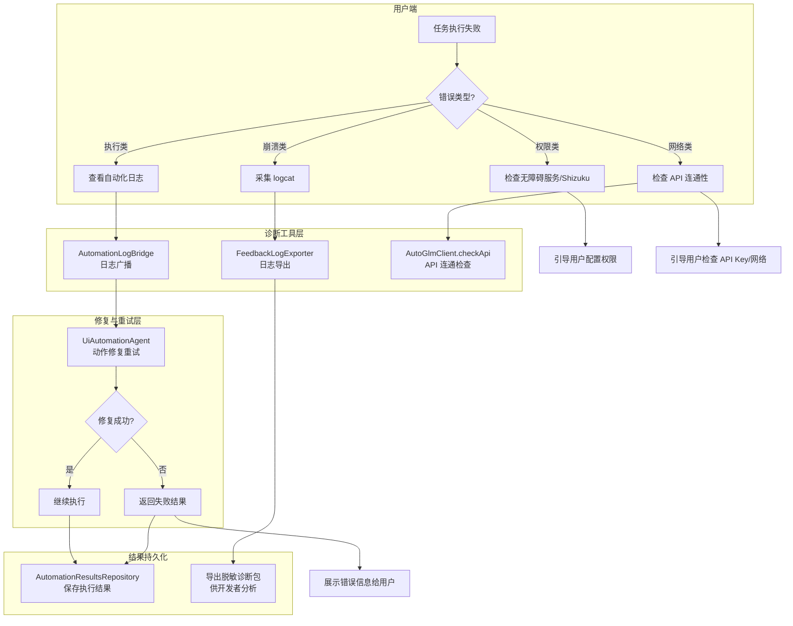
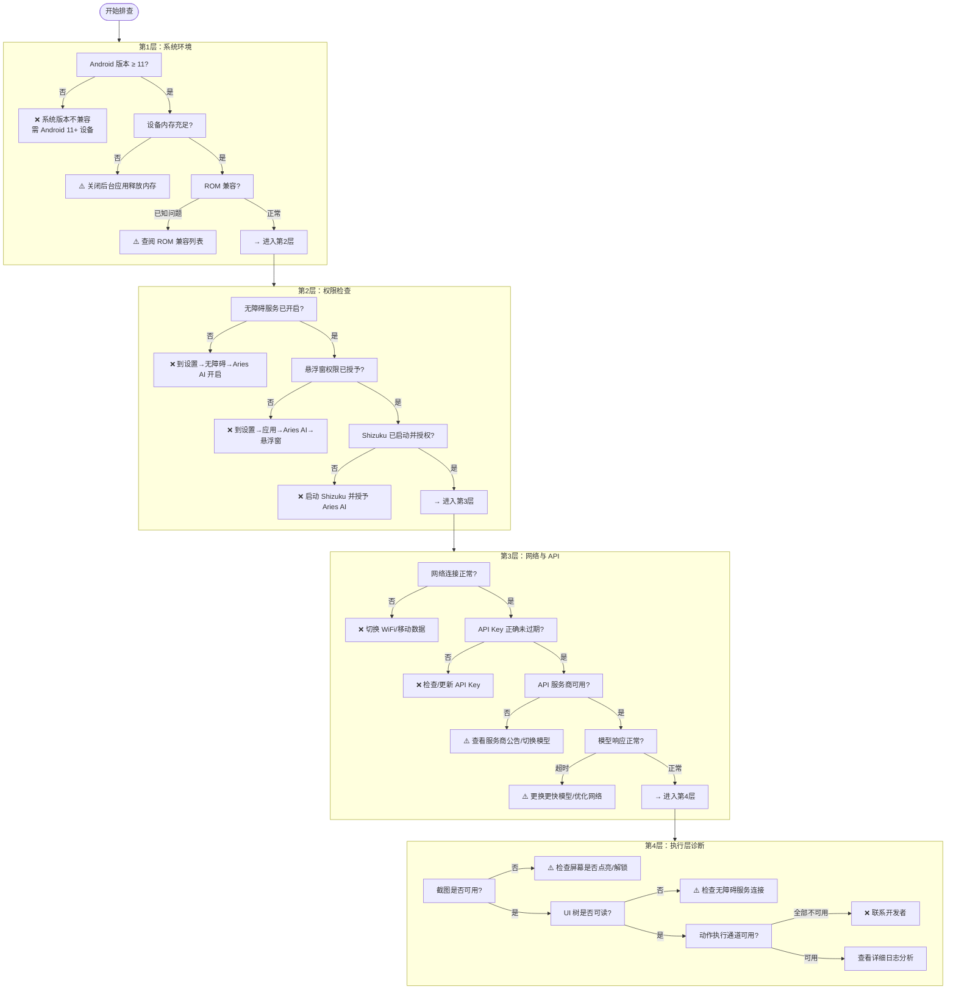
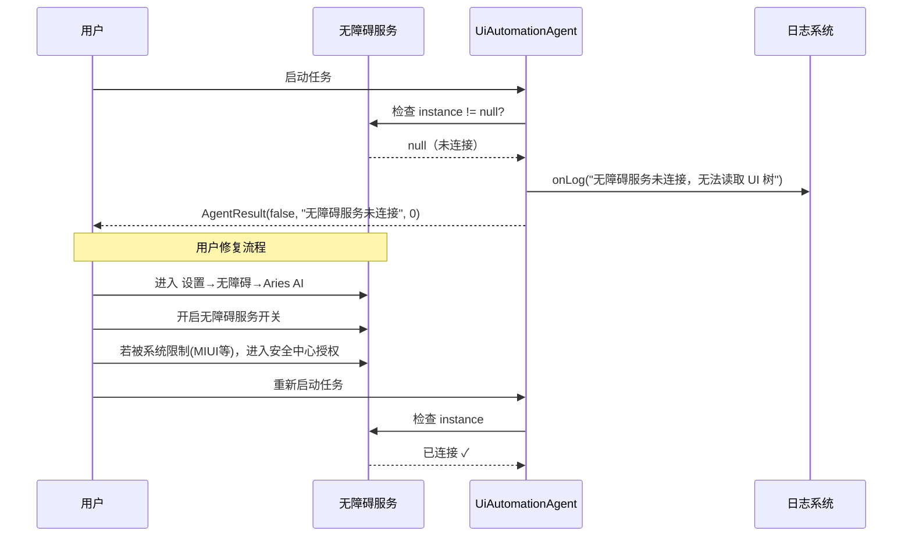
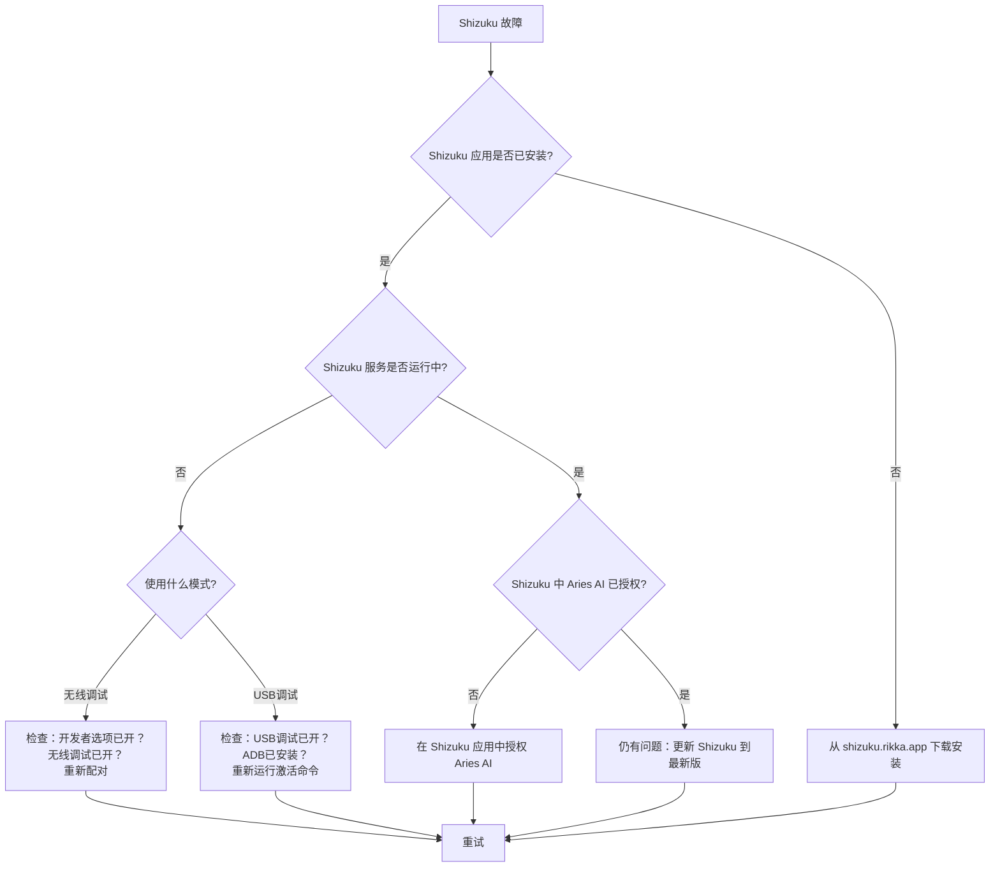
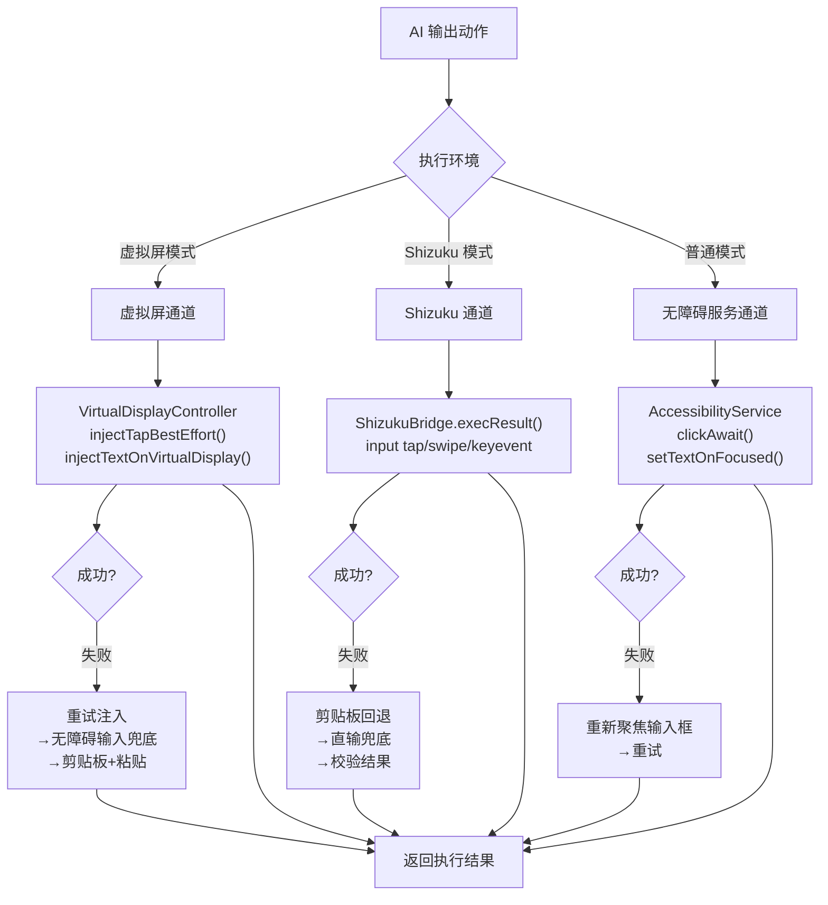

# 故障排查指南

> 本文档为 Aries AI 用户和开发者提供系统化的故障排查流程、诊断工具使用说明，以及常见问题的深度解决方案。当你遇到任务执行失败、应用闪退、虚拟屏黑屏等问题时，请参考本指南。

---

## 概述

Aries AI 是一个多层架构的 Android AI 自动化引擎，其正常运转依赖于多个组件协同工作：**无障碍服务**（UI 树读取与截图）、**Shizuku**（系统级权限与虚拟屏）、**大模型 API**（决策推理）、**ActionExecutor**（动作执行）。当任一环节出现异常时，会导致任务失败。

本指南从以下维度组织故障排查内容：

- **诊断工具**：日志导出、API 健康检查、执行结果回溯
- **分层排查**：按系统层 → 权限层 → 网络层 → 执行层的顺序逐级排查
- **核心组件故障**：针对无障碍服务、Shizuku、虚拟屏、API、动作执行等组件的专项排查
- **常见问题速查**：快速定位典型症状的解决方案

---

## 故障排查架构

Aries AI 在架构上提供了多层诊断能力。下图展示了故障发生后，从日志采集到用户反馈的完整排查链路：



### 诊断工具说明

| 工具/组件 | 用途 | 关键文件 |
|-----------|------|----------|
| **AutomationLogBridge** | 将自动化执行日志通过广播发送到主界面，实时展示每步操作 | [AutomationLogBridge.kt](https://github.com/ZG0704666/Aries-AI/blob/main/app/src/main/java/com/ai/phoneagent/core/automation/AutomationLogBridge.kt) |
| **FeedbackLogExporter** | 导出脱敏后的诊断包（含 metadata、最近执行结果、进程 logcat），自动脱敏邮箱/手机号/Token | [FeedbackLogExporter.kt](https://github.com/ZG0704666/Aries-AI/blob/main/app/src/main/java/com/ai/phoneagent/helper/FeedbackLogExporter.kt) |
| **AutomationResultsRepository** | 持久化最近一次任务的结果（成功/失败、步数、日志），供诊断和导出使用 | [AutomationResultsRepository.kt](https://github.com/ZG0704666/Aries-AI/blob/main/app/src/main/java/com/ai/phoneagent/data/preferences/AutomationResultsRepository.kt) |
| **AutoGlmClient.checkApi** | API 连通性快速检查，返回详细错误信息 | [AutoGlmClient.kt](https://github.com/ZG0704666/Aries-AI/blob/main/app/src/main/java/com/ai/phoneagent/net/AutoGlmClient.kt) |

---

## 分层排查流程

当任务执行出现问题时，请按照以下顺序逐层排查。每一层都可能包含多个检查点。这个流程的设计意图是：**从底层系统能力向上逐级验证，确保排查的高效性和准确性**。



---

## 核心组件故障排查

### 1. 无障碍服务故障

无障碍服务是 Aries AI 的核心依赖，负责屏幕截图和 UI 树读取。

**常见症状：**
- 任务无法启动，提示"无障碍服务未连接"
- 截图获取失败
- UI 树返回为空

**排查步骤：**



**关键代码——Agent 中的无障碍服务检查：**

```kotlin
// 无障碍服务断开时，Agent 会立即抛出异常终止任务
val rawUiDump = if (config.useBackgroundVirtualDisplay && ...) {
    "[虚拟屏模式-纯视觉驱动]"
} else if (config.useShizukuInteraction) {
    // Shizuku 模式走不同通道
} else {
    service?.dumpUiTreeWithRetry(maxNodes = config.uiTreeMaxNodes)
        ?: throw IllegalStateException("无障碍服务未连接，无法读取 UI 树")
}
```

> Source: [UiAutomationAgent.kt](https://github.com/ZG0704666/Aries-AI/blob/main/app/src/main/java/com/ai/phoneagent/UiAutomationAgent.kt#L260-L274)

**解决方案：**

1. **检查系统权限**：进入 `设置 → 无障碍 → 已下载的应用 → Aries AI`，确保开关已打开
2. **ROM 特殊处理**：MIUI 用户需进入 `安全中心 → 权限管理 → 允许 Aries AI 自启动和后台运行`；ColorOS/OneUI 用户类似
3. **强制重启**：在 `设置 → 应用管理 → Aries AI` 中先强制停止，再重新打开授权
4. **重启设备**：如果以上均无效，重启设备后重试

---

### 2. Shizuku 故障

Shizuku 为虚拟屏功能提供系统级权限，是后台自动化的基础。

**常见症状：**
- 虚拟屏无法创建（`displayId = null`）
- 日志提示 "Shizuku binder not ready"
- 日志提示 "Shizuku permission not granted"

**核心代码——Shizuku 状态检查与错误处理：**

```kotlin
// VirtualDisplayController 中的 Shizuku 可用性检查
if (!ShizukuBridge.pingBinder()) {
    Log.e(TAG, "Shizuku binder not ready - please start Shizuku app first")
    activeDisplayId = null
    return null
}
if (!ShizukuBridge.hasPermission()) {
    Log.e(TAG, "Shizuku permission not granted - please grant permission in Shizuku app")
    activeDisplayId = null
    return null
}
```

> Source: [VirtualDisplayController.kt](https://github.com/ZG0704666/Aries-AI/blob/main/app/src/main/java/com/ai/phoneagent/VirtualDisplayController.kt#L106-L114)

**Shizuku 故障排查流程：**



---

### 3. 虚拟屏故障

虚拟屏技术是 Aries AI 的核心差异化能力。虚拟屏黑屏或创建失败是最常见的深度故障。

**故障分类与诊断：**

| 故障类型 | 日志关键词 | 根因 | 解决方案 |
|----------|-----------|------|----------|
| Shizuku 未就绪 | `Shizuku binder not ready` | Shizuku 未启动 | 启动 Shizuku 应用 |
| 权限未授予 | `Shizuku permission not granted` | 未在 Shizuku 中授权 | 在 Shizuku 中授权 Aries AI |
| 虚拟屏创建失败 | `ensureStarted failed` | 系统/ROM 兼容性 | 尝试主屏模式 |
| 截图不可用 | `虚拟屏截图不可用` | 目标应用未正确启动 | 重启任务 |
| 虚拟屏黑屏 | 无明确错误日志 | 应用启动慢或焦点丢失 | 等待3-5秒或重启任务 |

**虚拟屏创建失败的完整处理链路：**

```kotlin
// UiAutomationAgent.run() 中的虚拟屏处理逻辑
if (config.useBackgroundVirtualDisplay) {
    onLog("【虚拟屏模式】正在准备后台虚拟屏...")
    val displayId = VirtualDisplayController.prepareForTask(context, "")
    if (displayId != null && displayId > 0) {
        onLog("【虚拟屏模式】虚拟屏已准备就绪，displayId=$displayId")
        // 成功：更新屏幕尺寸
    } else {
        // 虚拟屏创建失败，直接报错退出，不降级到主屏幕
        onLog("【虚拟屏模式】虚拟屏准备失败：Shizuku 未授权或创建失败")
        return AgentResult(false, "虚拟屏模式启动失败：请确保已安装 Shizuku 并授予权限", 0)
    }
}
```

> Source: [UiAutomationAgent.kt](https://github.com/ZG0704666/Aries-AI/blob/main/app/src/main/java/com/ai/phoneagent/UiAutomationAgent.kt#L131-L148)

**设计意图**：虚拟屏创建失败时，Agent 选择**直接报错退出**而非降级到主屏模式。这是有意为之——如果用户明确选择了后台虚拟屏模式但虚拟屏不可用，在主屏继续执行会占用用户前台屏幕，造成意外干扰。

---

### 4. API 调用故障

API 调用是连接大模型的关键环节。Aries AI 内置了完善的错误分类和重试机制。

**错误分类与重试策略：**

```kotlin
// ActionUtils 中的错误可重试性判断
fun isRetryableModelError(t: Throwable?): Boolean {
    if (t == null) return false
    if (t is CancellationException) return false           // 用户取消，不重试
    if (t is AutoGlmClient.ApiException) {
        if (t.code == 429) return true                     // 限流，可重试
        if (t.code in 500..599) return true                // 服务端错误，可重试
        return false                                        // 4xx 客户端错误，不重试
    }
    return t is IOException                                 // 网络 IO 错误，可重试
}
```

> Source: [ActionUtils.kt](https://github.com/ZG0704666/Aries-AI/blob/main/app/src/main/java/com/ai/phoneagent/core/utils/ActionUtils.kt#L115-L124)

**模型请求重试机制：**

```kotlin
// UiAutomationAgent 中的带重试模型请求
private suspend fun requestModelWithRetry(...): Result<String> {
    val maxAttempts = (config.maxModelRetries + 1).coerceAtLeast(1)
    var lastErr: Throwable? = null

    for (attempt in 0 until maxAttempts) {
        val result = withContext(Dispatchers.IO) {
            AutoGlmClient.sendChatResult(apiKey, baseUrl, messages, model, ...)
        }
        if (result.isSuccess) return result

        val err = result.exceptionOrNull()
        if (err is CancellationException) throw err
        lastErr = err

        val retryable = ActionUtils.isRetryableModelError(err)
        if (!retryable || attempt >= maxAttempts - 1) break

        val waitMs = ActionUtils.computeModelRetryDelayMs(attempt, config.modelRetryBaseDelayMs)
        onLog("[Step $step] $purpose 失败：${err?.message}（${attempt+1}/$maxAttempts），${waitMs}ms 后重试…")
        delay(waitMs)
    }
    return Result.failure(lastErr ?: IOException("Unknown model error"))
}
```

> Source: [UiAutomationAgent.kt](https://github.com/ZG0704666/Aries-AI/blob/main/app/src/main/java/com/ai/phoneagent/UiAutomationAgent.kt#L1136-L1196)

**API 故障排查速查表：**

| HTTP 状态码 | 含义 | 是否重试 | 用户操作 |
|-------------|------|----------|----------|
| 401 | API Key 无效 | 否 | 检查/更新 API Key |
| 403 | 无权访问模型 | 否 | 检查 API Key 权限范围 |
| 429 | 速率限制 | 是（指数退避） | 稍等后重试，或降低任务频率 |
| 5xx | 服务端错误 | 是（指数退避） | 等待服务恢复，或切换服务商 |
| 超时 | 网络/服务端慢 | 是 | 切换更快模型或优化网络 |

**重试延迟计算——指数退避策略：**

```kotlin
fun computeModelRetryDelayMs(attempt: Int, baseDelayMs: Long): Long {
    val base = baseDelayMs.coerceAtLeast(0L)
    val mult = 1L shl attempt.coerceIn(0, 6)  // 指数增长：1, 2, 4, 8...
    return (base * mult).coerceAtMost(6000L)    // 上限 6s
}
```

> Source: [ActionUtils.kt](https://github.com/ZG0704666/Aries-AI/blob/main/app/src/main/java/com/ai/phoneagent/core/utils/ActionUtils.kt#L38-L42)

---

### 5. 动作执行故障

动作执行器（ActionExecutor）采用多通道策略，确保在各类环境下都能最大可能完成操作。

**三通道执行策略：**



**设计意图**：ActionExecutor 的"通道 + 兜底"策略保证了在虚拟屏、Shizuku、无障碍服务三种差异化环境中都能尽力完成操作。例如，虚拟屏下文本输入失败的兜底链路为：`injectTextOnVirtualDisplay → 重试注入 → 无障碍输入兜底 → 提示模型改用 Tap 键盘逐字输入`。

**执行失败时的动作修复机制：**

Agent 在动作执行失败后，不会立即终止任务，而是会触发模型修复流程。修复流程会构造专门的修复提示（repair prompt），让模型基于失败上下文重新规划动作：

```kotlin
// 动作执行失败 → 修复流程
if (execOk) break  // 成功则跳出

if (repairAttempt >= config.maxActionRepairs) {
    return AgentResult(false, "动作执行失败：${currentAction.raw}", step)
}

repairAttempt++
onLog("[Step $step] 动作执行失败，尝试让模型修复（$repairAttempt/${config.maxActionRepairs})…")

// 构建修复消息并重新请求模型
val failMsg = PromptTemplates.buildActionRepairPrompt(currentAction.raw, enforceDesc)
history += ChatRequestMessage(role = "user", content = failMsg)
val fixResult = requestModelWithRetry(apiKey, baseUrl, model, messages = history, ...)
```

> Source: [UiAutomationAgent.kt](https://github.com/ZG0704666/Aries-AI/blob/main/app/src/main/java/com/ai/phoneagent/UiAutomationAgent.kt#L543-L627)

---

## 诊断工具使用指南

### 日志导出（FeedbackLogExporter）

当需要向开发者反馈问题时，使用内置的日志导出功能可以生成包含关键诊断信息的脱敏压缩包。

**导出内容：**
| 文件 | 内容 |
|------|------|
| `metadata.txt` | 设备型号、Android 版本、应用版本、配置项（虚拟屏/Shizuku/自动审批开关状态） |
| `automation_last_result.txt` | 最近一次任务的成功/失败状态、步数、完整日志 |
| `logcat_current_process.txt` | 当前进程的 logcat 输出（自动过滤敏感信息） |

**敏感信息自动脱敏：**
导出功能会自动识别并脱敏以下内容，确保安全分享：
- 邮箱地址 → `j***e@example.com`
- 手机号码 → `138****1234`
- API Token/Bearer → `abc***xy`
- Authorization/Cookie 等 Header 密钥 → `***`

```kotlin
// FeedbackLogExporter 的敏感信息脱敏正则
private val bearerRegex = Regex("""(?i)(bearer\s+)([A-Za-z0-9._\-+/=]+)""")
private val headerSecretRegex = Regex(
    """(?im)\b(authorization|cookie|set-cookie|x-api-key|api-key|token|
        access-token|refresh-token|password|secret)\b\s*[:=]\s*([^\r\n]+)""",
)
private val querySecretRegex = Regex(
    """(?i)([?&](?:token|access_token|refresh_token|api_key|apikey|
        secret|password)=)([^&\s]+)""",
)
```

> Source: [FeedbackLogExporter.kt](https://github.com/ZG0704666/Aries-AI/blob/main/app/src/main/java/com/ai/phoneagent/helper/FeedbackLogExporter.kt#L23-L34)

### 实时日志监控

Agent 执行过程中，每一步都会产生详细的日志输出，通过 `AutomationLogBridge` 广播到主界面：

```kotlin
object AutomationLogBridge {
    const val ACTION_AUTOMATION_LOG = "com.ai.phoneagent.action.AUTOMATION_LOG"

    fun publish(context: Context, line: String) {
        val normalized = line.trim()
        if (normalized.isBlank()) return
        val intent = Intent(ACTION_AUTOMATION_LOG).apply {
            setPackage(context.packageName)
            putExtra("automation_log_line", normalized)
        }
        context.sendBroadcast(intent)
    }
}
```

> Source: [AutomationLogBridge.kt](https://github.com/ZG0704666/Aries-AI/blob/main/app/src/main/java/com/ai/phoneagent/core/automation/AutomationLogBridge.kt#L6-L24)

**关键日志模式对照：**

| 日志模式 | 含义 | 处理建议 |
|----------|------|----------|
| `【虚拟屏模式】正在准备后台虚拟屏...` | 虚拟屏创建流程开始 | 正常 |
| `Shizuku binder not ready` | Shizuku 未启动 | 启动 Shizuku 应用 |
| `Shizuku permission not granted` | 权限未授予 | 在 Shizuku 中授权 |
| `[Step N] 请求模型…` | 向大模型发起 API 请求 | 正常 |
| `[Step N] 执行操作: 点击(N,M)` | 执行点击动作 | 正常 |
| `Shizuku 点击失败: exitCode=X` | Shizuku 点击命令失败 | 检查 Shizuku 状态 |
| `虚拟屏输入失败` | 虚拟屏文本注入未成功 | 会自动触发重试/兜底 |
| `动作执行失败，尝试让模型修复` | 触发动作修复流程 | 自动处理 |
| `达到最大步数限制` | 任务步数超出上限 | 简化任务或增大 maxSteps |

---

## 常见问题速查

### 问题一：应用闪退

**症状**：Aries AI 在使用过程中突然崩溃退出。

**排查步骤**：

1. **获取崩溃日志**：
   ```bash
   adb logcat -d | grep -E "AndroidRuntime|FATAL|AriesAgentApp|FloatingChatService"
   ```
2. **清除缓存**：进入 `设置 → 应用管理 → Aries AI` → 清除缓存和数据
3. **重新安装**：卸载后从 [GitHub Releases](https://github.com/ZG0704666/Aries-AI/releases) 下载最新版本
4. **检查兼容性**：确保 Android ≥ 11，建议 Android 12+；确保设备 RAM ≥ 4GB

### 问题二：虚拟屏黑屏

**症状**：虚拟屏预览窗口一直显示黑屏，没有应用画面。

**排查要点**（按优先级排序）：

1. 等待 3-5 秒——应用启动需要时间
2. 检查 Shizuku 状态是否正常
3. 如果是特定应用黑屏，可能是该应用不支持虚拟屏（某些银行/支付类应用有反虚拟屏检测）
4. 尝试切换到主屏模式执行

### 问题三：API 调用持续失败

**症状**：每次模型请求都返回错误。

**排查步骤**：

1. 验证 API Key 是否正确且未过期
2. 使用 `adb logcat -s AriesAgentApp` 查看具体错误码
   - `HTTP 401`：API Key 无效
   - `HTTP 429`：请求过于频繁，稍后重试
   - `HTTP 5xx`：服务商故障，等待恢复或切换
3. 检查 API 配额是否已用完
4. 尝试切换网络（WiFi ↔ 移动数据）

### 问题四：键盘输入失败

**症状**：AI 尝试在应用中输入文字但失败，或输入框中没有出现文字。

**设计背景**：虚拟屏下文本输入采用"剪贴板 + 粘贴"策略，而非直接键盘模拟。这是因为虚拟屏禁用了 IME 渲染以防止键盘焦点死锁。

**排查点**：
- 日志中 `[Type][Shizuku]` 相关行会详细展示输入策略的每一步（`clipboard_first → paste → direct_input → fallback`）
- 如果日志出现 `Type中文失败：下一步不要再输出Type，请直接Tap软键盘上的目标字键`，说明当前模型应改为逐键点击方式输入

### 问题五：添加 / 更换模型时卡死、点击无反应

**症状**：在 `设置 → 模型与 API 配置` 点击「更换模型」后界面没有反应；或对话框已弹出但点击列表项无响应；严重时整屏卡住。

**原因排序**（按可能性）：

1. **主线程 `runBlocking` DataStore 读 + AndroidKeyStore 解密**：`SettingsViewModel.openAriesModelSelectionDialog()` 曾在 Compose 点击回调里同步调用 `prefs.getActiveAriesApiKeyBlocking()`，该调用链会走到 `AndroidKeyStore.load()` + AES-GCM 解密（binder IPC），keystore2 繁忙时单次可达上百毫秒。
2. **静默失败**：原实现只有 `onSuccess` 分支会打开对话框，API Key 为空、请求失败、返回空列表这三种情况都不弹窗、不提示、也没有加载态，观感就是「点了没反应」。
3. **网络无硬超时**：`AriesApiClient.fetchModels()` 每次新建 `OkHttpClient` 且没有 `callTimeout`，慢速滴流响应可长时间无任何反馈。
4. **写入后立刻阻塞读同一个 DataStore**：`selectAriesModel()` 先异步写、紧接着同步读，连点会叠加主线程停顿。
5. **模式切换守卫吞掉点击**：`onApiModeChange()` 的 `apiModePersistJob?.isActive` 守卫在写入尚未落盘时直接 `return`，连 `applyApiModeState()` 都不执行。
6. **Aries 登录页永久遮罩**：登录流程的 `progressOverlay` 显示后从不隐藏，且收尾阶段没有超时；`finalizing` 卡住时返回设置页，「登录」按钮会一直停在加载态。

**定位步骤**：

```bash
# 1. 抓主线程卡顿与输入超时
adb logcat -d | grep -E "Input dispatching timed out|Choreographer|ANR in com.ai.phoneagent"

# 2. 抓 ANR traces 中的主线程栈
adb shell dumpsys activity anrinfo        # 或 adb bugreport 后查看 /data/anr/

# 3. 确认是否停在 DataStore / keystore
adb logcat -d | grep -E "DataStore|AndroidKeyStore|keystore2"
```

**修复要点**：

- `openAriesModelSelectionDialog()` 改为协程 + `Dispatchers.IO` 读取，点击后立即弹出对话框并展示加载态；失败时显示错误文案与「重试」按钮。
- 删除 `onApiModeChange()` 中吞点击的写入守卫，改为 toast 提示。
- `AriesApiClient` 增加 `callTimeout`，并复用 `modelsClient` 单例（不再每次新建连接池）。
- `SettingsViewModel.restoreSettings()` 改为「IO 取快照 → 主线程应用状态」。
- `AriesApiOAuthActivity` 在 `onDestroy` 中无条件回传登录结果，收尾阶段增加看门狗超时，`evaluateJavascript` 增加 5s 超时。

**验证方法**：

1. 首次进入 `设置 → 模型与 API 配置`，页面应立即可交互（无可感知停顿）。
2. 清空 API Key 后点击「更换模型」，应在 1 秒内出现对话框并提示需要登录，而不是无反应。
3. 断网后点击「更换模型」，应显示「获取模型列表失败」+ 重试按钮。
4. 快速连续点击模型列表项，界面不应卡顿，最终选中项与最后一次点击一致。
5. 登录 Aries 后中途返回设置页，再次点击「登录」应立即响应（不再永久加载态）。

### 问题六：打开 App 时提示「无响应」（ANR）

**症状**：冷启动或从后台切回时弹出系统 ANR 对话框，或启动后数秒内界面无法交互。

**原因排序**（按可能性；第 1 条已在 2026-10-10 用真机 ANR trace 证实）：

1. **`AppPrefsCompat` 的主线程 `runBlocking` 自锁死锁（已证实，最常见）**：`AppPrefsCompat.Editor.apply()` 的每个 key 都是一次 `runBlocking` 写。裸 `runBlocking { }` 会把续体排在**调用线程**的事件循环上；主线程正 park 在 `BlockingCoroutine.joinBlocking` 里，永远跑不到自己队列上的续体 ⇒ 永久死锁（输入事件 5 秒超时 → ANR，且不会自行恢复）。真机栈：`AppPreferencesRepository.writeApiConfigBlocking(AppPreferencesRepository.kt:803)` ← `MainActivity$AppPrefsCompat$Editor.apply(MainActivity.kt:252)` ← `MainActivity.onApiConfigChanged(MainActivity.kt:2895)` ← `MainActivity$onCreate$2$1$1.invokeSuspend(MainActivity.kt:765)`。
2. **`Application.onCreate` / `MainActivity.onCreate` 上的同步 DataStore 读**：`AppPrefsCompat` 的每个 `get*` 都是一次 `runBlocking` DataStore 读，首次启动还要先等 legacy 迁移完成。
3. **主线程 `runBlocking(Dispatchers.IO)`**：`tryRestoreConversations()` 用 `runBlocking(Dispatchers.IO)` 读 Room 对话表与活跃会话 ID —— `runBlocking` 只切换执行线程，调用线程仍被阻塞。
4. **外部存储 I/O**：`ModelScopeModelDownloader.isQwen35ModelReady()` 会调用 `getExternalFilesDir()` 并对 9-10 个模型文件做 `exists()/length()`，此前在 5 处主线程被调用。
5. **`DownloadManager.query()` 跨进程 IPC**：`reconcilePendingQwenDownloads()` 在主线程执行 `dm.query()`。
6. **AndroidKeyStore 解密**：`restoreApiKey()` 中的 `getActiveAriesApiKeyBlocking()` 会在每次 `onResume` 触发。
7. **`Settings.canDrawOverlays` / `Settings.Secure` Binder IPC**：在 `MainOnboardingOverlay` 的字段初始化与 `onResume` 路径上同步执行。

**定位步骤**：

```bash
# 冷启动并记录耗时
adb shell am start -W -n com.ai.phoneagent/.MainActivity
adb logcat -d | grep -E "ANR in|Input dispatching timed out|Slow (main thread|operation)"

# 取主线程栈（logcat 被 ROM 屏蔽时用 bugreport）
adb bugreport /sdcard/br.zip && adb pull /sdcard/br.zip
# 解包后看 FS/data/anr/anr_<时间戳> 里的 "main" 线程栈：
#   停在 kotlinx.coroutines.BlockingCoroutine.joinBlocking / runBlocking 即本条原因

# 定位主线程磁盘 I/O（debug 包启用 StrictMode 后）
adb logcat -d | grep -E "StrictMode|DiskReadViolation|DiskWriteViolation"
```

**修复要点**：

- `AppPrefsCompat` 彻底去阻塞：改为「内存缓存 + 串行异步写队列（`Channel` + `Dispatchers.IO` 作用域）」，`ready` 状态经 `mutableStateOf` 暴露，读操作全部走缓存，`Editor.apply()` 只更新缓存并投递异步写。
- **`runBlocking { }` → `runBlocking(Dispatchers.IO) { }`**：`AppPreferencesRepository` / `FloatingChatPreferencesRepository` / `ToolPermissionsRepository` / `VirtualDisplayConfigRepository` / `AutomationResultsRepository` 的全部 `*Blocking()` 辅助方法统一改造。传入 dispatcher 后 `joinBlocking` 不再需要调用线程的事件循环，续体在 IO worker 上推进 ⇒ 即使仍从主线程调用也不会自锁死锁。
- 冷启动路径上的 DataStore 读全部改为 `lifecycleScope.launch + withContext(Dispatchers.IO)`。
- `tryRestoreConversations()` 改为 `restoreConversationsAsync(onFinished)`，Room 读取放到 IO 后再回主线程更新 UI。
- `restoreApiKey()`、`checkUserAgreement()`、`reconcilePendingQwenDownloads()`、`refreshLocalModelReadyState()`、`updateLocalModelSwitchAvailabilityUi()` 等相关读全部异步化。
- `AppPreferencesRepository` 新增一批非阻塞读取，原 `*Blocking()` 改为委托，供协程调用点使用。
- API Key 通过 `apiKeyFlow` / `activeAriesApiKeyFlow` 在 IO 上镜像到 `@Volatile` 字段，点击与发送路径不再触发 keystore 解密。
- 悬浮窗：`cacheMessagesForNextStart` 改为「进程内内存交接 + 异步落盘」，`saveMessagesToPrefs` / `saveWindowState` 改为串行异步写。

**验证方法**：

1. 冷启动计时：`adb shell am start -W -n com.ai.phoneagent/.MainActivity`，对比修复前后的 `TotalTime` 与首帧时间。
2. 反复「杀进程 → 冷启动」20 次，不应再出现 ANR。
3. 从悬浮窗返回主界面、缩小到小窗等路径不应出现可感知卡顿。
4. 若临时启用 StrictMode（仅 debug），主线程不应出现 `DiskReadViolation`。

### 问题七：输入框被输入法遮挡 / 主页面输入栏弹出键盘后「消失」

**症状 A（二级页面）**：点击屏幕中下部的输入框（如 `设置 → 模型与 API 配置` 的 Base URL / 模型名 / API Key）后，输入框被弹出的键盘挡住，不会被抬高。

**症状 B（主页面）**：在主页面底部输入栏点击输入，键盘弹出后**输入栏整条消失**（被键盘完全盖住），关闭键盘后又出现；聊天正文会正常上移。

**根因**：`MainActivity.setupEdgeToEdge()` 调用了 `WindowCompat.setDecorFitsSystemWindows(window, false)`。开启 edge-to-edge 后，AndroidManifest 中的 `adjustResize` 不再自动调整窗口，**必须由 Compose 自行消费 IME inset**。

- 症状 A 是「承载输入框的滚动容器没有 `imePadding()`」——此前全仓库只有 `HomeScreen` 一处使用了 `imePadding()`，其余页面只做了 `navigationBarsPadding()`。
- 症状 B 是「消费 IME inset 的层级放错」：`HomeScreen` 只给**正文区**加了 `imePadding()`，而输入栏（`HomeBottomOverlay`）是正文区的**兄弟节点**、以 `Alignment.BottomCenter` 贴在外层全屏 `Box` 的底部 —— 键盘弹出时正文上移、输入栏不动，于是被键盘盖住。修法是让**共同父容器**消费 IME inset（`Box(Modifier.fillMaxSize().windowInsetsPadding(WindowInsets.ime))`），正文与输入栏一起上移；正文自身再保留 `imePadding()` 会重复计算。

**定位步骤**：

```bash
# 1. 确认窗口软键盘模式与 edge-to-edge 状态（adjustResize 是否被 edge-to-edge 顶掉）
adb shell dumpsys window | grep -E "mSoftInputMode|decorFitsSystemWindows"
# 2. 确认输入法窗口是否弹出、高度多少
adb shell dumpsys input_method | grep -E "mInputShown|mImeWindowVis"
# 3. 打开「开发者选项 → 显示布局边界」，观察输入栏是否被键盘区域覆盖
# 4. 用 uiautomator 抓语义树，确认输入栏节点的 bounds 是否仍贴在屏幕底部（未被上抬）
adb shell uiautomator dump /sdcard/ui.xml && adb pull /sdcard/ui.xml
# 5. 打开「指针位置」/ 录屏，确认键盘弹出前后输入栏 bounds 是否变化
adb shell screenrecord /sdcard/ime.mp4   # 键盘弹出后 Ctrl+C 结束，再 adb pull
```

**修复要点**：

- 症状 A：给承载输入框的滚动容器追加 `.imePadding()`（已处理 `DrawerSettingsScreen` 与 `DrawerModelApiConfigScreen` 的 `LazyColumn`、`HomeScreen` 的抽屉内容容器、`AutomationControlScreen` 的任务列表）。其他含输入框且只用了 `navigationBarsPadding()` 的页面（对话框、BottomSheet、Onboarding、更新历史等）按同样方式补 `imePadding()`。
- 症状 B：把 `.imePadding()` 从正文区上移到**正文 + 输入栏的共同父容器**，并改用 `.windowInsetsPadding(WindowInsets.ime)`（需要 `import androidx.compose.foundation.layout.ime` —— 它是 `WindowInsets.Companion` 的扩展属性，漏 import 会报 `Unresolved reference 'ime'`）。判断口诀：**谁和输入框一起动，就让谁消费 IME inset**；贴底元素与其兄弟必须共享同一个被 inset 收缩的父容器。

**验证方法**：逐个打开含输入框的页面，点击最靠下的输入框，确认输入框完整可见且与键盘之间无重叠；主页面点击输入栏后确认输入栏整体上移到键盘之上（而不是被盖住）；关闭键盘后输入栏回到原位、正文不残留空白；旋转屏幕、切换深色模式后复测。

### 问题八：启动时提示「语音模型初始化失败」

**症状**：每次启动都弹 Toast「语音模型初始化失败：…」（旧版本文案为「语音模型初始化失败」/「语音模型初始化失败，请重试」），语音输入不可用。

**结论（2026-10-10 已定位）**：不是权限、不是初始化时机，而是**依赖与资源双重缺失**：

1. **native 库未打进 APK**：`app/src/main/cpp/CMakeLists.txt` 在 `thirdparty/sherpa-ncnn/CMakeLists.txt` 缺失时只打印 WARNING 并跳过构建；`git submodule status` 显示 `thirdparty/ncnn`、`thirdparty/sherpa-ncnn` 均未初始化（前导 `-`）。因此 APK 的 `lib/arm64-v8a/` 里没有 `libsherpa-ncnn-jni.so`，`System.loadLibrary("sherpa-ncnn-jni")` 必然抛 `UnsatisfiedLinkError`。
2. **模型资源未打进 APK（现已改为按需下载）**：`.gitignore` 忽略了 `app/src/main/assets/sherpa-models/**`，包内只有 `README.md`。自 2026-10-11 起模型**不再随包分发**（打进包会让安装包多 124.5 MB），改为首次使用时由 App 下载到 `filesDir/sherpa-ncnn-streaming-zipformer-bilingual-zh-en-2023-02-13/`；未下载时语音初始化会跳过并提示「离线语音模型未下载，请在「设置 → 模型与 API」中下载」，而不是报「初始化失败」。

**修复要点**：

- 代码侧（已完成）：`SherpaSpeechRecognizer.ensureModelDirReady()` 在拷贝后**校验 `requiredFiles`**（此前 `copyAssetDirRecursive` 对「目录里只有 README.md」不抛异常，会把不完整目录当成成功结果交给 native 层，掩盖真实原因）；新增 `InitFailure` 失败分级（`NATIVE_LIBRARY_UNAVAILABLE` / `MODEL_ASSETS_MISSING` / `NATIVE_LIBRARY_AND_MODEL_ASSETS_MISSING` / `RECOGNIZER_CREATE_FAILED`）与对应的用户可读文案；模型目录准备加进程级互斥锁，避免 MainActivity 与 AutomationViewModel 两个实例并发重复拷贝上百 MB。
- 构建侧（需手动执行一次）：

```bash
git submodule update --init --recursive          # 1. 拉取 ncnn 与 sherpa-ncnn 源码
Remove-Item -Recurse -Force app\.cxx, app\build\intermediates\cxx   # 2. 清理陈旧的 CMake 配置缓存（关键）
./gradlew assembleDebug                          # 3. CMake 构建 libsherpa-ncnn-jni.so
```

> 第 2 步是**必需**的：CMake 只跟踪自己读过的文件，新的 `thirdparty/sherpa-ncnn/CMakeLists.txt` 不会触发重新配置，构建会沿用旧的「跳过 native 构建」结论（`:app:configureCMakeDebug`/`:app:buildCMakeDebug` 秒级结束、APK 里仍无 `.so`）。首次重新配置会联网拉取 `kaldi-native-fbank`、`kaldifst`、`json`、`openfst`。

- 资源侧（现为运行时下载，无需再打进 APK）：进入「设置 → 模型与 API → 离线语音模型」，点「下载离线语音模型（约 135 MB）」，App 会从 `hf-mirror.com`（失败回退 `huggingface.co`）逐文件下载并校验字节数，支持断点续传。开发期若想离线调试，仍可把 7 个文件放进 `app/src/main/assets/sherpa-models/sherpa-ncnn-streaming-zipformer-bilingual-zh-en-2023-02-13/`（assets 兜底路径保留），但不要提交：

```bash
curl.exe -L --fail -o model.tar.bz2 `
  https://github.com/k2-fsa/sherpa-ncnn/releases/download/models/sherpa-ncnn-streaming-zipformer-bilingual-zh-en-2023-02-13.tar.bz2
tar.exe -xjf model.tar.bz2
Copy-Item sherpa-ncnn-streaming-zipformer-bilingual-zh-en-2023-02-13\* `
  app\src\main\assets\sherpa-models\sherpa-ncnn-streaming-zipformer-bilingual-zh-en-2023-02-13\
```

- 仓库已按上述步骤完成一次修复：APK 内 `lib/arm64-v8a/libsherpa-ncnn-jni.so`（打包后 4.28 MB，未剥离 11.1 MB）已确认存在；`.so` 已导出 `Java_com_k2fsa_sherpa_ncnn_SherpaNcnn_*` 全部 JNI 符号（`newFromFile`/`newFromAsset`/`acceptWaveform`/`decode`/`isReady`/`getText`/`inputFinished`/`isEndpoint`/`reset`/`delete`），与 `app/src/main/java/com/k2fsa/sherpa/ncnn/SherpaNcnn.kt` 的 `external fun` 声明及 `jni.cc` 中的 `GetFieldID` 字段名逐一对应。模型文件则改由 `app/src/main/java/com/ai/phoneagent/speech/SherpaModelRepository.kt` 在运行时下载（`assets/sherpa-models/` 现只保留 `README.md`）。

**验证方法**：

1. `unzip -l app/build/outputs/apk/debug/app-debug.apk | grep -E "sherpa-ncnn-jni|sherpa-models"` 应看到 `.so`，而 `assets/sherpa-models` 只应有 `README.md`（模型已外置）。
2. 下载完成后启动，Toast 不再出现，状态栏显示「语音模型已就绪」（`status_ready`）；`adb shell run-as com.ai.phoneagent ls files/` 能看到 `sherpa-ncnn-streaming-zipformer-bilingual-zh-en-2023-02-13/` 目录及 7 个文件（合计 141,346,210 B）。
3. 若仍失败，提示会指明具体缺失项（原生库 / 模型未下载 / 两者）；`adb logcat -s SherpaSpeechRecognizer` 可见 `Speech model is not downloaded yet` 或 `Sherpa native library is unavailable`。

### 问题九：点击「设置」直接闪退

**症状**：从抽屉点「设置」（或任何入口进入设置页）立即闪退，没有 Toast、也没有 ANR 弹窗；其他页面一切正常。

**结论（2026-10-11 已定位并修复）**：`AriesSquircleShape`（连续曲率圆角）的采样在端点处算出 **NaN** 坐标，导致 `Modifier.border` 建遮罩位图时崩溃。真机栈（HONOR BKQ-AN10 / Android 17）：

```text
java.lang.IllegalArgumentException: width and height must be > 0
	at android.graphics.Bitmap.createBitmap(Bitmap.java:1723)
	at androidx.compose.ui.graphics.Api26Bitmap.createBitmap-x__-hDU(AndroidImageBitmap.android.kt:198)
	at androidx.compose.ui.graphics.ImageBitmapKt.ImageBitmap-x__-hDU(ImageBitmap.kt:255)
	at androidx.compose.foundation.BorderModifierNode.drawGenericBorder(Border.kt:529)
	…
	at androidx.compose.foundation.BackgroundNode.draw(Background.kt:163)
```

触发链（四条环环相扣，缺一条都不会崩）：

1. `Modifier.border(width, color, shape)` 对**泛型形状**（既不是矩形、也不是简单圆角矩形）走 `drawGenericBorder`：它取 `shape.createOutline().path.getBounds()` 取整后建一张 `ImageBitmap` 当描边遮罩。
2. 采样循环 `val t = (i.toFloat() / steps) * (PI / 2).toFloat()` 的**端点**比真正的 π/2 略大（`1.5707964`），于是 `cos(t) = -4.371139e-08` 为负；`(-4.37e-8f).pow(0.5f)` 在 JVM/ART 上返回 **NaN**，NaN 污染整条路径的坐标，`path.getBounds()` 退化成 NaN/0。
3. `IntSize(ceil(NaN).toInt() = 0, 0)` → `ImageBitmap(0, 0)` → `Bitmap.createBitmap` 抛 `IllegalArgumentException`。
4. 设置页每个分组卡都是 `AriesGlassPanel(shape = rememberAriesSaltCardShape())`（12dp 超椭圆），于是「点设置」100% 闪退。

**修复要点**（已完成）：

- `core/designsystem/src/main/java/com/ai/phoneagent/core/designsystem/theme/AriesGlass.kt`：8 处采样改为 `sin(t).coerceAtLeast(0f).pow(power)` / `cos(t).coerceAtLeast(0f).pow(power)`（端点 `cos` 取 0，几何上正是角点应有的值）；`createOutline` 的早退守卫补上 `!width.isFinite() || !height.isFinite()`——`NaN <= 0f` 为 false，原来的守卫挡不住 NaN。
- 新增 `Modifier.ariesGlassBorder(shape, color, width)`：纯矢量描边（`drawWithCache` + `Path` + `drawPath(style = Stroke)`），**完全不建位图**，尺寸退化时直接不画；已替换 `AriesGlassPanel`、`AriesGlassIconButton`、`AriesGlassChip`、`SettingsRoute` 的 Aries 模型对话框、`HomeScreen` 的抽屉描边。
- 通用规则：**自定义 `Shape` 不要走 `Modifier.border`**。超椭圆、单角圆角这类泛型形状会走位图路径，任何一帧尺寸未定（动画首帧、被约束压到 0、含 NaN）都会崩。

**验证方法**：

1. 安装新包后从抽屉进入设置页，页面正常显示，分组卡带发丝描边。
2. 复现原路径：设置 → 模型与 API → 打开「Aries 模型选择」对话框，不再闪退。
3. 若仍有崩溃，debug 包会弹「上次运行崩溃了」对话框，点「复制」即可拿到栈（`AriesCrashReporter` 同时落盘到 `files/crash/last_crash.txt`）。

---

## 配置选项参考

以下是与故障排查相关的关键配置参数，适当调整这些参数可以提升稳定性或改变重试行为：

| 参数 | 类型 | 默认值 | 说明 | 故障排查用途 |
|------|------|--------|------|-------------|
| `maxSteps` | Int | 100 | 最大执行步数 | 如果任务总是超步数失败，检查是否陷入循环 |
| `maxModelRetries` | Int | 3 | 模型请求最大重试次数 | 网络不稳定时可增大 |
| `modelRetryBaseDelayMs` | Long | 700 | 重试基础延迟(ms)，支持指数退避 | 配合 maxModelRetries 使用 |
| `maxParseRepairs` | Int | 2 | 输出解析修复最大次数 | 模型输出格式不稳定时可增大 |
| `maxActionRepairs` | Int | 1 | 动作执行修复最大次数 | 可增大来提升执行成功率，但会增加耗时 |
| `stepDelayMs` | Long | 160 | 每步之间基础延迟(ms) | 增加可减少因 UI 未刷新导致的误判 |
| `screenshotCompressionQuality` | Int | 85 | 截图压缩质量(0-100) | 降低可减少 API 数据传输量 |
| `enableScreenshotCache` | Boolean | true | 是否启用截图缓存 | 开启可减少重复截图 |
| `useStreamingWithEarlyStop` | Boolean | true | 流式输出+早停 | 开启可降低延迟 |

> Source: [AgentConfiguration.kt](https://github.com/ZG0704666/Aries-AI/blob/main/app/src/main/java/com/ai/phoneagent/core/config/AgentConfiguration.kt)

---

## API 连通性检查

Aries AI 提供了 API 连通性检查接口，可以在设置界面或通过代码快速验证 API 是否可用：

```kotlin
// AutoGlmClient 的 API 检查方法
suspend fun checkApiDetailed(
    apiKey: String,
    baseUrl: String = DEFAULT_BASE_URL,
    model: String = DEFAULT_MODEL,
): ApiCheckResult

data class ApiCheckResult(
    val ok: Boolean,
    val statusCode: Int? = null,
    val message: String? = null,
)
```

> Source: [AutoGlmClient.kt](https://github.com/ZG0704666/Aries-AI/blob/main/app/src/main/java/com/ai/phoneagent/net/AutoGlmClient.kt#L361-L451)

当 `ok = false` 时，`message` 会包含具体的错误原因，如：
- `HTTP 401`：API Key 无效
- `"Insufficient quota"`：配额不足
- `"Invalid model"`：模型名称错误
- `"Network request failed"`：网络不通

---

## 反馈问题模板

向开发者反馈问题时，请通过 **FeedbackLogExporter** 导出诊断包，并附上以下信息：

```markdown
### 设备信息
- 设备型号：例如 Xiaomi 14
- Android 版本：例如 Android 14 (SDK 34)
- ROM 版本：例如 HyperOS 1.0.5.0

### 应用信息
- Aries AI 版本：例如 v1.4.3-beta
- Shizuku 版本：例如 13.5.4

### 问题描述
- 详细描述问题现象
- 复现步骤
- 预期行为 vs 实际行为

### 附加信息
- 使用的模型：例如 glm-4.6v-flash
- 任务描述：例如"在美团搜索附近的火锅店"
- 已尝试的解决方案
```

---

## 相关链接

- [FAQ 常见问题解答](https://github.com/ZG0704666/Aries-AI/blob/main/Aries-site/docs/FAQ.md) — 用户常见问题汇总
- [技术概述文档](https://github.com/ZG0704666/Aries-AI/blob/main/Aries-site/docs/TECHNICAL_OVERVIEW.md) — 核心技术实现详解
- [构建指南](https://github.com/ZG0704666/Aries-AI/blob/main/Aries-site/docs/BUILDING.md) — 开发者环境配置
- [Git 工作流](https://github.com/ZG0704666/Aries-AI/blob/main/Aries-site/docs/GIT_WORKFLOW.md) — 贡献代码流程
- [GitHub Issues](https://github.com/ZG0704666/Aries-AI/issues) — 提交 Bug 报告
- [GitHub Discussions](https://github.com/ZG0704666/Aries-AI/discussions) — 社区讨论
- [Shizuku 官方文档](https://shizuku.rikka.app/zh-hans/) — Shizuku 安装与配置
- [智谱开放平台](https://open.bigmodel.cn/) — 获取 GLM API Key
- [QQ 群：746439473](http://qm.qq.com/cgi-bin/qm/qr?_wv=1027&k=&authKey=&noverify=0&group_code=746439473) — 社区交流

---

**文档版本**：v1.0  
**最后更新**：2026-04-09  
**维护人**：ZG0704666

---

<div align="center">

**遇到本文档未覆盖的问题？欢迎加入 QQ 群 746439473 或通过 GitHub Issues 反馈！**

</div>
